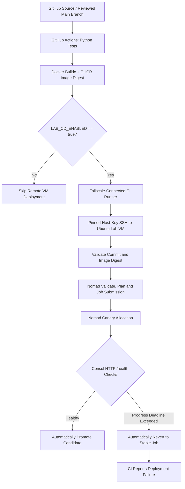

# Nomad Automatic Rollback Lab

**A reproducible DevOps lab for containerized application delivery, health-gated canary deployments, and automatic recovery with HashiCorp Nomad.**

## 1. Project Introduction

The Nomad Automatic Rollback Lab demonstrates how a delivery pipeline can detect an unhealthy application release and recover without promoting the failed candidate. It combines **GitHub Actions**, **Docker**, **GitHub Container Registry (GHCR)**, **HashiCorp Nomad**, and **Consul**. For the remote CI/CD demonstration, **Tailscale** and **SSH with a pinned host key** provide access to an isolated Ubuntu lab VM.

The project uses a Flask application with `/health` and `/version` endpoints. Healthy changes pass service checks and are promoted, while intentionally unhealthy candidates fail deployment health checks and trigger Nomad's configured automatic reversion. The CI/CD workflow still reports the failed candidate deployment as a failure, even when the previous healthy release is restored successfully.

**Project Scope:** A personal, isolated development and validation environment. The project does not deploy to production or authorize changes to company infrastructure.

## 2. Project Overview

The project addresses a common challenge in application deployment: a newly released version may fail health checks or become unstable after deployment.

Without an automated recovery mechanism, engineers may need to identify the failure and manually restore a previous working version.

This lab demonstrates a controlled delivery process in which:

1. Application changes are tested automatically through GitHub Actions.
2. Docker images are built and published to GHCR.
3. Authorized releases are submitted to a Nomad environment.
4. Nomad deploys a canary instance before promoting the candidate.
5. Consul monitors application health through HTTP checks.
6. Healthy candidates are automatically promoted.
7. Unhealthy candidates trigger automatic reversion to the previous stable job configuration.
8. GitHub Actions reports the deployment failure even when recovery succeeds.

The result is a reproducible example of health-based deployment governance, automated rollback and operational recovery.

## 3. Project Objectives

- Develop a containerized Flask application with health and version endpoints.
- Automate application testing using GitHub Actions.
- Build and publish versioned Docker images to GitHub Container Registry.
- Deploy immutable container images through HashiCorp Nomad.
- Configure canary deployments with automatic promotion.
- Integrate Consul health checks into deployment decisions.
- Automatically revert failed releases without manual intervention.
- Validate manual rollback and recovery procedures.
- Ensure deployment failures are correctly reported by the CI/CD pipeline.
- Provide a one-command setup script for local lab installation.
- Maintain reproducible documentation, reports and validation evidence.

## 4. Technology Stack

| Technology | Purpose |
|---|---|
| Python | Application development and automated testing |
| Flask | Sample web application and health endpoints |
| Gunicorn | Python application server |
| Docker | Application containerization |
| GitHub Actions | Automated testing, image publishing and deployment |
| GitHub Container Registry | Docker image storage |
| HashiCorp Nomad | Container orchestration and deployment management |
| HashiCorp Consul | Service registration and health checks |
| Tailscale | Secure network connectivity for the remote CI/CD demonstration |
| SSH | Controlled remote deployment access |
| Ubuntu Linux | Local application and orchestration environment |
| Git and GitHub | Version control and project collaboration |

## 5. Deployment Architecture



### Architecture Explanation

The delivery workflow begins when reviewed changes are merged into the repository's `main` branch.

GitHub Actions executes automated tests, creates a Docker image and publishes it to GHCR. When remote deployment is explicitly enabled, the workflow connects to the isolated Ubuntu lab through Tailscale and SSH.

Nomad validates the deployment specification and starts a canary allocation. Consul performs HTTP health checks to evaluate the candidate.

If the candidate remains healthy, Nomad promotes the deployment. If it fails to meet deployment health requirements within the configured deadline, Nomad automatically reverts to the previous stable configuration.

The CI/CD workflow retains the failed deployment result, ensuring that application recovery does not incorrectly mark an unsuccessful release as successful.

**Note:** This architecture describes the complete remote CI/CD workflow. The local installation procedure below sets up Docker, Nomad, Consul and the sample application. GitHub Actions credentials and Tailscale access require separate configuration.

---

## 6. Getting Started — Installation and Setup

This section provides step-by-step instructions for cloning the repository and setting up the Nomad Automatic Rollback Lab on Ubuntu.

### Step 1 — System Requirements

Use a dedicated Ubuntu machine or virtual machine.

**Supported Operating Systems:**

- Ubuntu 24.04 LTS
- Ubuntu 26.04 LTS

**Requirements:**

- A user account with sudo privileges
- Internet access for initial installation
- Sufficient CPU, RAM and storage for Docker, Nomad, Consul and the sample application
- A clean lab environment without conflicting Nomad or Consul installations

The setup script installs system packages and configures systemd services. It should only be executed on an isolated development or testing machine.

### Step 2 — Update Ubuntu Packages

Open the Ubuntu terminal and execute:

```bash
sudo apt-get update
sudo apt-get install -y git ca-certificates
```

Verify the Git installation:

```bash
git --version
```

Git should display its installed version.

### Step 3 — Clone the GitHub Repository

Clone the project:

```bash
git clone https://github.com/atiqa-ai/nomad-auto-rollback-lab.git
```

Navigate into the project directory:

```bash
cd nomad-auto-rollback-lab
```

Verify that the setup script exists:

```bash
ls -l scripts/setup-lab.sh
```

The repository contains the application source code, Docker configuration, Nomad job specification, automation scripts, documentation and validation evidence.

### Step 4 — Run the Automated Setup

Execute the one-command installation script:

```bash
./scripts/setup-lab.sh
```

The script is designed to perform the following operations:

1. Verify the supported Ubuntu environment.
2. Install required system packages.
3. Install Docker if it is not already available.
4. Install HashiCorp Nomad and Consul.
5. Configure dedicated Nomad and Consul systemd services.
6. Initialize the Python virtual environment.
7. Install application dependencies.
8. Execute the Python unit tests.
9. Build the sample Flask application Docker image.
10. Validate the Nomad job specification.
11. Submit the healthy sample application to Nomad.

The script may request your sudo password during package installation or service configuration.

To save an installation log on a fresh machine, use:

```bash
set -o pipefail
./scripts/setup-lab.sh 2>&1 | tee "$HOME/nomad-fresh-bootstrap.log"
```

**Important:** Completing the installation command does not automatically guarantee that the application is healthy. Follow the verification steps below.

### Step 5 — Verify Docker Installation

Check the installed Docker version:

```bash
docker --version
```

Verify the Docker service:

```bash
systemctl is-active docker
```

Expected service status:

```text
active
```

### Step 6 — Verify Nomad and Consul

Check the Nomad version:

```bash
nomad version
```

Check the Consul version:

```bash
consul version
```

Verify both services:

```bash
systemctl is-active nomad-rollback-lab
systemctl is-active consul-rollback-lab
```

Both services should report `active` after successful installation.

### Step 7 — Verify the Nomad Client

Run:

```bash
nomad node status
```

The configured Nomad client should report:

```text
Status
ready
```

This indicates that the Nomad client is registered and ready to accept scheduled workloads.

### Step 8 — Verify the Deployed Application

Check the Nomad job:

```bash
nomad job status rollback-demo
```

Inspect the deployment history:

```bash
nomad job deployments rollback-demo
```

For a successful deployment, verify that:

- The Nomad job is running.
- The latest deployment is successful.
- The desired application allocation is running.
- The deployment health checks are passing.

If the application is still starting, inspect its deployment status before proceeding.

### Step 9 — Verify Application Health

Run the project's health-verification script:

```bash
bash scripts/phase4-verify.sh
```

For a healthy installation, the script prints a PASS result containing the discovered application address, application version and health status.

Example output format:

```text
PASS: http://<lab-ip>:<port>, version=<version>, health=healthy
```

The actual application address and port depend on the local environment.

For a specific CI-deployed release, the script also accepts the first 12 hexadecimal characters of the deployed commit SHA:

```bash
bash scripts/phase4-verify.sh ea3ff5145bc7
```

Use this example SHA only when that exact version has been deployed to the machine. A fresh local installation may use a different version.

### Step 10 — Run Application Unit Tests

Execute:

```bash
.venv/bin/python -m unittest discover -s tests -v
```

The validated project test suite contains nine Python unit tests.

All tests should pass in a healthy installation.

### Step 11 — Verify the Complete Lab Environment

Run:

```bash
./scripts/setup-lab.sh --check
```

This command checks the existing environment without intentionally modifying the deployed application.

For a healthy installation, the script reports a successful verification result.

The normal setup command can also detect an existing healthy `rollback-demo` deployment and skip redundant installation and deployment.

However, the script is not guaranteed to repair a partially failed initial installation. If setup fails, investigate the error logs before rerunning it.

### Step 12 — Access the Nomad Web Interface

The lab configures the Nomad HTTP API on the local loopback interface.

On the lab machine, open:

```text
http://127.0.0.1:4646/ui/
```

From the Nomad dashboard, developers can inspect:

- Registered clients
- Running jobs
- Application allocations
- Deployment history
- Canary status
- Deployment failures and recovery activity

The Nomad administrative interface should not be exposed publicly.

---

## 7. Local Setup and GitHub Actions CI/CD

The local installation and remote GitHub Actions workflow serve different purposes.

| Environment | Function |
|---|---|
| Local Ubuntu setup | Installs Docker, Nomad and Consul, then deploys the sample application |
| GitHub Actions CI | Runs Python tests and builds/publishes Docker images |
| GitHub Actions CD | Deploys an authorized image to the isolated Nomad VM |
| Consul monitoring | Evaluates registered application health |
| Nomad deployment controller | Manages canary promotion and automatic rollback |

### Local Setup

For developers who only want to run the sample application on Ubuntu:

```bash
git clone https://github.com/atiqa-ai/nomad-auto-rollback-lab.git
cd nomad-auto-rollback-lab
./scripts/setup-lab.sh
./scripts/setup-lab.sh --check
```

### Remote CI/CD Setup

Remote GitHub Actions deployment requires separate repository configuration, including authorized network connectivity, deployment credentials, and SSH host-key verification.

The workflow uses the repository variable:

```text
LAB_CD_ENABLED
```

When set to `false`, the remote Nomad deployment is skipped.

When set to `true`, an authorized `main` workflow can attempt deployment to the configured lab environment.

The bootstrap script does not automatically provision GitHub Actions secrets, Tailscale identities or remote deployment credentials.

Keep automatic deployment disabled unless an authorized test is in progress.

---

## 8. Nomad Canary Deployment Configuration

The project uses a controlled Nomad update strategy.

The validated configuration includes:

```hcl
update {
  max_parallel      = 1
  canary            = 1
  auto_promote      = true
  auto_revert       = true
  health_check      = "checks"
  min_healthy_time  = "10s"
  healthy_deadline  = "2m"
  progress_deadline = "4m"
}
```

### Configuration Explanation

| Parameter | Purpose |
|---|---|
| `max_parallel` | Limits concurrent task replacements |
| `canary` | Creates a candidate allocation for validation |
| `auto_promote` | Automatically promotes healthy candidates |
| `auto_revert` | Reverts failed deployments to the previous stable job |
| `health_check` | Uses registered health checks for evaluation |
| `min_healthy_time` | Requires a minimum healthy period |
| `healthy_deadline` | Limits the time allowed to become healthy |
| `progress_deadline` | Limits time allowed for deployment progress |

### Consul Health Check

The application registers an HTTP health check using:

```hcl
check {
  name     = "flask-health"
  type     = "http"
  path     = "/health"
  interval = "5s"
  timeout  = "2s"
}
```

These settings were validated for the isolated sample application. They are not automatically suitable for production workloads.

---

## 9. Verified Project Results

The following outcomes were recorded during the project validation exercises on 13 November 2026.

| Validation | Recorded Result |
|---|---|
| Python unit tests | 9/9 passed |
| Docker image publishing | Successful |
| Nomad canary deployment | Successful |
| Consul health checks | Passed |
| Healthy candidate promotion | Successful |
| Automatic rollback | Successfully demonstrated |
| Manual rollback | Successfully demonstrated |
| CI/CD failure propagation | Verified |
| One-command setup script | Implemented and merged |
| Push-triggered healthy deployment | Successful |
| Final documentation workflow | Successful |

### Automatic Rollback Verification

An intentionally unhealthy application candidate was submitted through the deployment workflow.

The candidate failed deployment health evaluation, triggering automatic reversion to the previous stable Nomad configuration.

The previous healthy service was recovered, while the GitHub Actions deployment job still reported the candidate deployment failure.

**Verified GitHub Actions run:**

[Automatic Rollback and CI Failure Verification](https://github.com/atiqa-ai/nomad-auto-rollback-lab/actions/runs/43442086173)

### Manual Rollback Verification

The manual recovery exercise used:

```bash
nomad job revert rollback-demo 4
```

The command completed successfully during the recorded test.

The measured recovery execution was approximately 12 seconds for that exercise.

### Healthy Push-Triggered Deployment

The final healthy deployment was verified after a reviewed change was merged into `main`.

| Verification | Result |
|---|---|
| GitHub Actions run | `43481759119` |
| Commit | `ea3ff5145bc7` |
| Nomad job version | `9` |
| Deployment ID | `ef6bf59a` |
| Deployment status | Successful |
| Canary promotion | Successful |
| Healthy allocations | 1 |
| Unhealthy allocations | 0 |
| Application health | Healthy |

[View Successful Push-Triggered Deployment](https://github.com/atiqa-ai/nomad-auto-rollback-lab/actions/runs/43481759119)


**Historical evidence:** Earlier Phase 5 tests used application version `v2` and Nomad job version `8`. The later successful push-triggered deployment used job version `9`. Both are retained as separate validation records.

**Fresh-VM evidence:** Setup on a separate VM was reported as successful, but its original clean-bootstrap logs have not been independently reviewed in this documentation.

---

## 10. Project Documentation

| Document | Description |
|---|---|
| [Final Technical Report](reports/Nomad_Automatic_Rollback_Final_Report_GitHub.md) | Implementation, results and conclusions |
| [Project Completion Summary](docs/PROJECT_COMPLETION_SUMMARY.md) | Completed work and outcomes |
| [Architecture Documentation](docs/architecture.md) | Architecture and component design |
| [Installation and Reproducibility](docs/INSTALLATION_AND_REPRODUCIBILITY.md) | Detailed installation instructions |
| [Validation Report](docs/VALIDATION.md) | Tests, evidence and acceptance status |
| [Operational Runbook](docs/OPERATIONAL_RUNBOOK.md) | Deployment operations and recovery |
| [Deployment Review Checklist](docs/DEPLOYMENT_REVIEW_CHECKLIST.md) | Deployment configuration and safety review |
| [Final Handover Checklist](docs/FINAL_HANDOVER_CHECKLIST.md) | Project deliverables and acceptance |
| [Phase 5 Rollback Report](docs/PHASE5_ROLLBACK_TEST_REPORT.md) | Automatic and manual rollback evidence |
| [Push-Triggered Deployment Verification](docs/PUSH_TRIGGERED_DEPLOYMENT_TEST.md) | Verified deployment through GitHub Actions |
| [Evidence Index](docs/EVIDENCE_INDEX.md) | Screenshot and log evidence |
| [Screenshot Guide](screenshots/README.md) | Screenshots and figure captions |

### Project Evidence Screenshots

The repository includes eight screenshots documenting the deployment environment and validation results.

1. Infrastructure services and Nomad client
2. Flask application unit tests
3. Successful GitHub Actions CI/CD
4. Nomad job deployment overview
5. Manual rollback recovery
6. Expected GitHub Actions deployment failure
7. CI-triggered automatic rollback
8. Final Nomad service health

[View Project Screenshots](screenshots/)

These screenshots represent recorded test results rather than live deployment monitoring.

---

## 11. Troubleshooting

### Check Docker

```bash
sudo systemctl status docker --no-pager
```

### Check Consul

```bash
sudo systemctl status consul-rollback-lab --no-pager
```

### Check Nomad

```bash
sudo systemctl status nomad-rollback-lab --no-pager
```

### Inspect Nomad Logs

```bash
sudo journalctl -u nomad-rollback-lab -n 50 --no-pager
```

### Inspect Consul Logs

```bash
sudo journalctl -u consul-rollback-lab -n 50 --no-pager
```

### Check Nomad Client

```bash
nomad node status
```

### Check Application

```bash
nomad job status rollback-demo
```

### Verify Health

```bash
bash scripts/phase4-verify.sh
```

If a deployment fails, review Nomad deployment history and Consul health checks before initiating manual recovery.

For advanced troubleshooting, refer to the [Operational Runbook](docs/OPERATIONAL_RUNBOOK.md).

---

## 12. Security and Safety Considerations

- Run the project only on an isolated lab machine or authorized test environment.
- Never commit SSH private keys, access tokens or Tailscale authentication secrets.
- Keep Nomad and Consul administrative APIs restricted to trusted interfaces.
- Use pinned SSH host keys for remote deployment.
- Deploy container images using immutable references.
- Use intentional failure testing only within the isolated lab.
- Restore `LAB_CD_ENABLED=false` after authorized deployment testing.
- Review deployment configuration before adapting the project to another environment.
- Production deployment requires separate authorization and engineering assessment.

---

## 13. Project Status and Handover

The Nomad Automatic Rollback Lab demonstrates a complete application delivery and recovery workflow using Docker, GitHub Actions, Nomad and Consul.

The validated technical implementation includes automated testing, image publishing, health-gated canary deployment, successful candidate promotion, automatic rollback, manual recovery and CI/CD failure propagation.

The repository also contains installation instructions, a one-command bootstrap script, architecture documentation, operational procedures, technical reports, deployment review checklists and evidence screenshots.

**Current Status:** Core implementation and functional validation completed. Documentation integrated into the repository. Final organizational acceptance remains subject to mentor or authorized engineer review.

**Repository:** https://github.com/atiqa-ai/nomad-auto-rollback-lab

**Project Scope:** Isolated DevOps lab and reproducible demonstration. No production deployment is claimed.

## linked documentation

All links below open directly into the matching file within this extracted package. Preserve the folder structure when copying documentation into the Git repository.

| Document | Use it for |
| --- | --- |
| **[Final project report](docs/PROJECT_REPORT.md)** | Executive summary, objective, design, implementation, verified results, screenshots, conclusion |
| [Project completion summary](docs/PROJECT_COMPLETION_SUMMARY.md) | One-page verified work and outcomes for submission |
| [Architecture and technical design](docs/architecture.md) | Component responsibilities, flows, Nomad policy, network and data boundaries |
| [Installation and reproducibility](docs/INSTALLATION_AND_REPRODUCIBILITY.md) | Prerequisites, initial setup, verification and known reproducibility gaps |
| [Consolidated validation and acceptance matrix](docs/VALIDATION.md) | Pass/fail results and explicit unverified acceptance conditions |
| [Operational runbook](docs/OPERATIONAL_RUNBOOK.md) | Safe deployment, verification, triage and manual recovery commands |
| [Screenshot and log evidence index](docs/EVIDENCE_INDEX.md) | Eight evidence images, saved log inventory, correct interpretation |
| [Final handover checklist](docs/FINAL_HANDOVER_CHECKLIST.md) | Deliverables, outstanding checks and transfer steps |
| [Documentation audit and proofreading](docs/DOCUMENTATION_AUDIT.md) | Corrected outdated claims, verified file links and report formatting 
| [Screenshot folder guide](screenshots/README.md) | Direct image links and ready-to-use figure captions |

**Viewing evidence images:** The standalone Markdown report embeds its eight PNGs directly, but some Markdown viewers block embedded images for security. If pictures are not visible in your viewer, open the **offline HTML preview** in a browser. For GitHub, use the **GitHub-compatible Markdown report** with the `screenshots/` directory kept alongside it in the extracted folder hierarchy.

## Verified system at a glance

| Area | Verified outcome |
| --- | --- |
| Application | Flask/Gunicorn service, `/health` and `/version`; health behavior controlled for lab testing |
| Tests | **9/9 Python unit tests** passed in a terminal session on the VM `mariana` |
| Containerization | Docker image built/published and immutable GHCR digest deployed |
| Orchestration | Nomad service job `rollback-demo`, one running allocation after final recovery |
| Health | Consul HTTP check; final independent verification returned `version=v2`, `health=healthy` |
| CI/CD | Successful full pipeline: GitHub Actions run **43426413120** |
| Failure propagation | Deliberately unhealthy CI deployment failed: run **43442086173**, deployment step exit `1` |
| Automatic rollback | Failed CI canary reverted to stable Nomad job version **6**; recovery version **8** succeeded |
| Manual rollback | `nomad job revert rollback-demo 4` returned `0`; recovery execution took **12 seconds** |
| Final job status | Nomad job version **8** stable; last observed deployment `f2b389f5` successful |

**Observed timing:** First unhealthy v3 command completed in **252 seconds including failure detection and recovery**. In the CI-triggered exercise, the recorded interval from failure/rollback log to successful recovery was approximately **12 seconds**. These are **not measurements of customer-facing outage duration**, and they are not equivalent test intervals.

## Workflow summary

1. Review/merge code to `main`; CI runs the Python tests.
2. On `main` runs, publish an image with a commit-specific tag and immutable SHA256 digest to GHCR.
3. If `LAB_CD_ENABLED=true`, connect the GitHub-hosted runner to the isolated VM over tagged Tailscale access and pinned-host-key SSH.
4. On the VM, validate the commit and image digest, evaluate the Nomad plan, and submit an update with a compare-and-swap job index.
5. Nomad starts a canary. Consul and application `/health` checks determine whether it qualifies for promotion.
6. A failed canary triggers configured automatic reversion to the last stable job; CI preserves the failed rollout result even after recovery.
7. Operators can also run an explicit manual revert for incident recovery.

See the [architecture](docs/architecture.md), [release guide](docs/PHASE4_VM_GUIDE.md), and [incident runbook](docs/OPERATIONAL_RUNBOOK.md) for details.

## Repository layout

```text
app/                         Flask service
  app.py                     HTTP endpoints and health behavior
  requirements.txt           Application dependencies
tests/test_health.py         Nine application unit tests
Dockerfile                   Gunicorn container image
nomad/rollback-demo.nomad.hcl Nomad job with canary/health/revert policy
.github/workflows/ci-cd.yml CI tests, GHCR publishing and VM deployment
scripts/                     Preflight, monitored deployment, verification
README.md                    Documentation entrypoint
docs/                        Technical and operational documents
reports/                     Final Markdown report
screenshots/                 Redacted/selected evidence captures
```

The deliverable ZIP contains the **documentation, Markdown report and evidence images**, not a replacement copy of the application's source code. Copy only the documentation files you intend to merge into the existing Git repository; do not overwrite `app/`, `nomad/`, `.github/`, or `scripts/` with documentation artifacts.

##  screenshot evidence

The following eight visual records supplement the test-result tables and log summary.


![Infrastructure services and Nomad client]
(

*Figure 01 — Docker, Nomad and Consul service readiness, plus Nomad client state.*

![Flask application unit tests](

*Figure 02 — Nine passing Python application unit tests in the Ubuntu VM.*

![Successful GitHub Actions CI/CD](

*Figure 03 — Verified healthy release with passing tests, image publish and VM deployment.*

![Nomad job overview](

*Figure 04 — Post-recovery Nomad job overview: stable version 8 and healthy allocation.*

![Manual rollback recovery output](

*Figure 05 — Manual recovery event reaches a successful job version; original command in the saved log.*

![Expected GitHub Actions deployment failure](

*Figure 06 — Controlled unhealthy candidate: test/build jobs passed and deployment failed.*

![CI-triggered automatic rollback log](

*Figure 07 — Deadline failure, revert to stable configuration and CI exit code 1.*

![Final Nomad service dashboard](

*Figure 08 — Final successful Nomad deployment dashboard; independent HTTP v2 health is recorded separately.*


