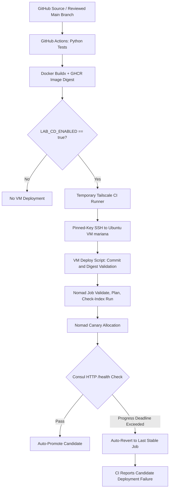

# Nomad Automatic Rollback Lab

**Project status:** Five engineering phases verified; project documentation and handover consolidated on **13 November 2026**. The lab is running a healthy `v2` demonstration service on a dedicated Ubuntu VM. GitHub's automatic deployment switch was set to `false` after testing.

This repository demonstrates a controlled application delivery pipeline using **GitHub Actions, Docker, GitHub Container Registry (GHCR), HashiCorp Nomad, Consul, Tailscale, and SSH**. Healthy canaries can be promoted; intentionally unhealthy canaries are rejected, Nomad restores the last stable configuration, and the initiating CI/CD job still reports failure.


## Deployment Topology




## linked documentation

All links below open directly into the matching file within this extracted package. Preserve the folder structure when copying documentation into the Git repository.

| Document | Use it for |
| --- | --- |
| **[Final project report](docs/PROJECT_REPORT.md)** | Executive summary, objective, design, implementation, verified results, screenshots, conclusion |

| [Final report — offline browser preview (.html)](reports/Nomad_Automatic_Rollback_Final_Report_Offline.html) | Self-contained view with all evidence images visible in a browser |
| [Final report — GitHub-compatible (.md)](reports/Nomad_Automatic_Rollback_Final_Report_GitHub.md) | Same wording with relative PNG links, suited to viewing inside the extracted project folder or GitHub repo |
| [Project completion summary](docs/PROJECT_COMPLETION_SUMMARY.md) | One-page verified work and outcomes for submission |
| [Architecture and technical design](docs/architecture.md) | Component responsibilities, flows, Nomad policy, network and data boundaries |
| [Installation and reproducibility](docs/INSTALLATION_AND_REPRODUCIBILITY.md) | Prerequisites, initial setup, verification and known reproducibility gaps |
| [Consolidated validation and acceptance matrix](docs/VALIDATION.md) | Pass/fail results and explicit unverified acceptance conditions |
| [Operational runbook](docs/OPERATIONAL_RUNBOOK.md) | Safe deployment, verification, triage and manual recovery commands |
| [Deployment review checklist](docs/DEPLOYMENT_REVIEW_CHECKLIST.md) | Pre-deployment, promotion, revert and post-release checks |
| [Screenshot and log evidence index](docs/EVIDENCE_INDEX.md) | Eight evidence images, saved log inventory, correct interpretation |
| [Final handover checklist](docs/FINAL_HANDOVER_CHECKLIST.md) | Deliverables, outstanding checks and transfer steps |
| [Documentation audit and proofreading](docs/DOCUMENTATION_AUDIT.md) | Corrected outdated claims, verified file links and report formatting 
| [Screenshot folder guide](screenshots/README.md) | Direct image links and ready-to-use figure captions |

**Viewing evidence images:** The standalone Markdown report embeds its eight PNGs directly, but some Markdown viewers block embedded images for security. If pictures are not visible in your viewer, open the **offline HTML preview** in a browser. For GitHub, use the **GitHub-compatible Markdown report** with the `screenshots/` directory kept alongside it in the extracted folder hierarchy.

## Verified system at a glance

| Area | Verified outcome |
| --- | --- |
| Application | Flask/Gunicorn service, `/health` and `/version`; health behavior controlled for lab testing |
| Tests | **9/9 Python unit tests** passed in a terminal session on the VM `mariana` |
| Containerization | Docker image built/published and immutable GHCR digest deployed |
| Orchestration | Nomad service job `rollback-demo`, one running allocation after final recovery |
| Health | Consul HTTP check; final independent verification returned `version=v2`, `health=healthy` |
| CI/CD | Successful full pipeline: GitHub Actions run **43426413120** |
| Failure propagation | Deliberately unhealthy CI deployment failed: run **43442086173**, deployment step exit `1` |
| Automatic rollback | Failed CI canary reverted to stable Nomad job version **6**; recovery version **8** succeeded |
| Manual rollback | `nomad job revert rollback-demo 4` returned `0`; recovery execution took **12 seconds** |
| Final job status | Nomad job version **8** stable; last observed deployment `f2b389f5` successful |

**Observed timing:** First unhealthy v3 command completed in **252 seconds including failure detection and recovery**. In the CI-triggered exercise, the recorded interval from failure/rollback log to successful recovery was approximately **12 seconds**. These are **not measurements of customer-facing outage duration**, and they are not equivalent test intervals.

## Workflow summary

1. Review/merge code to `main`; CI runs the Python tests.
2. On `main` runs, publish an image with a commit-specific tag and immutable SHA256 digest to GHCR.
3. If `LAB_CD_ENABLED=true`, connect the GitHub-hosted runner to the isolated VM over tagged Tailscale access and pinned-host-key SSH.
4. On the VM, validate the commit and image digest, evaluate the Nomad plan, and submit an update with a compare-and-swap job index.
5. Nomad starts a canary. Consul and application `/health` checks determine whether it qualifies for promotion.
6. A failed canary triggers configured automatic reversion to the last stable job; CI preserves the failed rollout result even after recovery.
7. Operators can also run an explicit manual revert for incident recovery.

See the [architecture](docs/architecture.md), [release guide](docs/PHASE4_VM_GUIDE.md), and [incident runbook](docs/OPERATIONAL_RUNBOOK.md) for details.

## Repository layout

```text
app/                         Flask service
  app.py                     HTTP endpoints and health behavior
  requirements.txt           Application dependencies
tests/test_health.py         Nine application unit tests
Dockerfile                   Gunicorn container image
nomad/rollback-demo.nomad.hcl Nomad job with canary/health/revert policy
.github/workflows/ci-cd.yml CI tests, GHCR publishing and VM deployment
scripts/                     Preflight, monitored deployment, verification
README.md                    Documentation entrypoint
docs/                        Technical and operational documents
reports/                     Final Markdown report
screenshots/                 Redacted/selected evidence captures
```

The deliverable ZIP contains the **documentation, Markdown report and evidence images**, not a replacement copy of the application's source code. Copy only the documentation files you intend to merge into the existing Git repository; do not overwrite `app/`, `nomad/`, `.github/`, or `scripts/` with documentation artifacts.

##  screenshot evidence

The following eight visual records supplement the test-result tables and log summary.


![Infrastructure services and Nomad client]
(

*Figure 01 — Docker, Nomad and Consul service readiness, plus Nomad client state.*

![Flask application unit tests](

*Figure 02 — Nine passing Python application unit tests in the Ubuntu VM.*

![Successful GitHub Actions CI/CD](

*Figure 03 — Verified healthy release with passing tests, image publish and VM deployment.*

![Nomad job overview](

*Figure 04 — Post-recovery Nomad job overview: stable version 8 and healthy allocation.*

![Manual rollback recovery output](

*Figure 05 — Manual recovery event reaches a successful job version; original command in the saved log.*

![Expected GitHub Actions deployment failure](

*Figure 06 — Controlled unhealthy candidate: test/build jobs passed and deployment failed.*

![CI-triggered automatic rollback log](

*Figure 07 — Deadline failure, revert to stable configuration and CI exit code 1.*

![Final Nomad service dashboard](

*Figure 08 — Final successful Nomad deployment dashboard; independent HTTP v2 health is recorded separately.*

## Quick verification on the existing VM

Run inside **`mariana`**, not on a physical host or production server:

```bash
cd ~/nomad-auto-rollback-lab
systemctl is-active docker consul nomad
python3 -m unittest discover -s tests -v
nomad job status rollback-demo
nomad job history rollback-demo
bash scripts/phase4-verify.sh
gh variable list
```

Expected for the documented final state: Nomad running, passing Consul service, application `v2` healthy, and `LAB_CD_ENABLED=false`. Values may change after subsequent releases; record fresh evidence instead of assuming historical IDs remain current. The verification script **without** an expected SHA is appropriate for the `v2` demo; its optional argument is restricted to a 12-character hexadecimal commit ID.

## Safety and evidence handling

- Never commit SSH private keys, OAuth secrets, Tailscale auth keys, `.env` files, or private `authfile` content.
- Do not publish Nomad (`4646`) or Consul (`8500`) APIs to public networks. Their lab API endpoints were bound to loopback.
- The test switch `failure_test=true` intentionally creates an unhealthy canary; enable only for an authorized, isolated demonstration, and disable `LAB_CD_ENABLED` afterward.
- Version, job IDs, deployment IDs, timestamps, and screenshots here are **historical evidence dated 13 November 2026**.
- For remaining gaps, see [validation](docs/VALIDATION.md), and [handover](docs/FINAL_HANDOVER_CHECKLIST.md).
