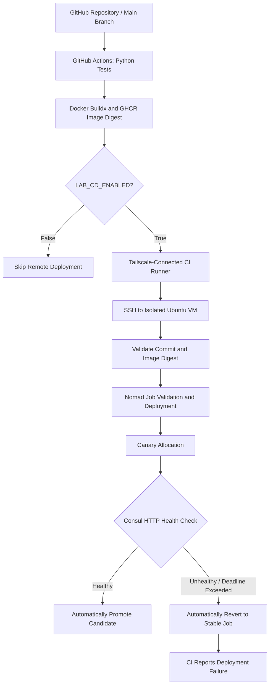
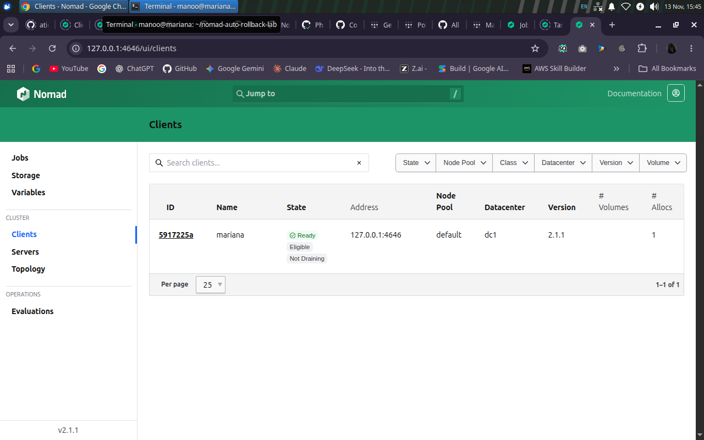
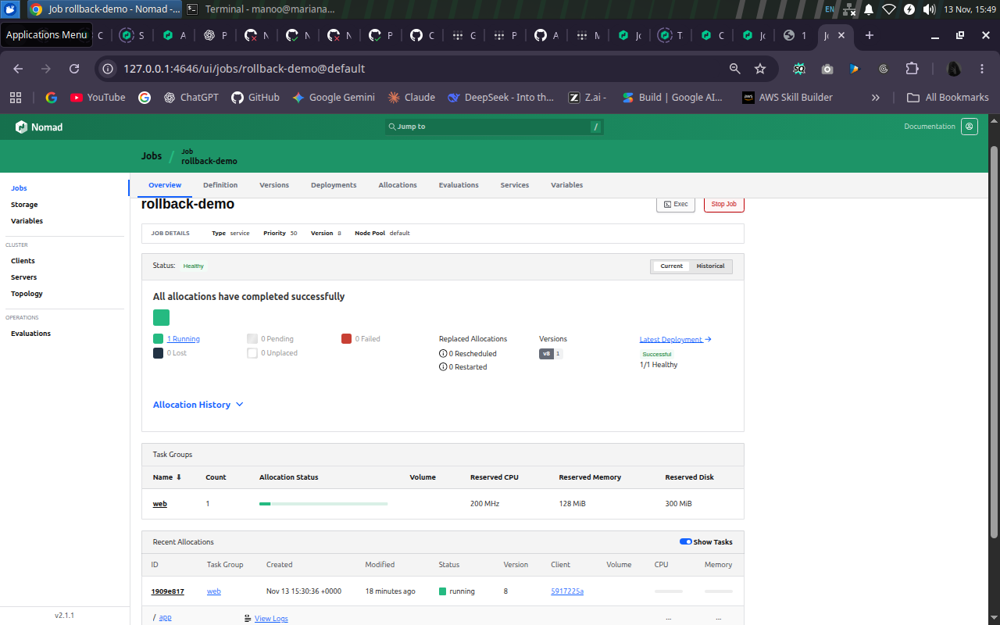

# pipeline with canary and automated rollback on Nomad

### Automated CI/CD, Health-Gated Canary Deployment and Self-Recovery with HashiCorp Nomad

A reproducible DevOps project demonstrating how to build, test, deploy, monitor and automatically recover containerized applications using GitHub Actions, Docker, HashiCorp Nomad and Consul.

**Project Status:** Core implementation and functional validation completed.

**Environment:** Isolated Ubuntu Linux lab

**Repository:** https://github.com/atiqa-ai/nomad-auto-rollback-lab

---

## 1. Project Introduction

- The Nomad Automatic Rollback Lab is a DevOps automation project designed to demonstrate reliable application deployment and recovery.

- The project integrates GitHub Actions, Docker, GitHub Container Registry (GHCR), HashiCorp Nomad, Consul, Tailscale and SSH into a controlled application delivery workflow.

- Its primary objective is to identify unhealthy application releases, prevent failed candidates from being promoted and automatically restore the previously stable deployment configuration.

- A lightweight Python Flask application serves as the demonstration service. It provides health and version endpoints that enable Nomad and Consul to assess deployment readiness.

= The system supports automated CI/CD, progressive canary deployment, continuous health verification, automatic rollback and manual recovery.


## 2. Project Overview

### Problem Statement

Application deployments can introduce failures caused by configuration changes, application defects or unhealthy service instances.

Without effective deployment controls, an unsuccessful release may require engineers to investigate the failure and manually restore a stable version.

This project addresses that challenge through health-gated application deployment and automated rollback.

### Proposed Solution

The system implements a controlled deployment workflow that:

1. Detects changes merged into the GitHub repository.
2. Executes automated application tests.
3. Builds and publishes a Docker image to GHCR.
4. Deploys an authorized application release to HashiCorp Nomad.
5. Evaluates a canary allocation using Consul health checks.
6. Automatically promotes a healthy candidate.
7. Reverts an unhealthy candidate to the previous stable job configuration.
8. Reports deployment failure in GitHub Actions even when recovery succeeds.


## 3. Technology Stack

| Technology | Purpose |
|---|---|
| Python | Application development and automated tests |
| Flask | Sample application with health and version endpoints |
| Gunicorn | Python application server |
| Docker | Application containerization |
| GitHub Actions | Automated CI/CD workflows |
| GitHub Container Registry | Container image publishing |
| HashiCorp Nomad | Scheduling, canary deployment and rollback |
| HashiCorp Consul | Service registration and health checks |
| Tailscale | Private connectivity for remote CI/CD |
| SSH | Controlled deployment access to the Ubuntu VM |
| Ubuntu Linux | Local orchestration environment |
| Git and GitHub | Source control and collaboration |

---

## 4. System Architecture

The project follows a Git-based CI/CD pipeline integrated with a Nomad-managed application on isolated environment.



### Architecture Workflow

The application source code is maintained in GitHub.

When a change is merged into `main`, GitHub Actions executes the Python unit tests and builds a Docker image.

The image is published to GHCR using a commit-specific reference and immutable image digest.

If remote deployment is explicitly enabled, the workflow connects to the isolated Ubuntu VM over Tailscale and pinned-host-key SSH.

Nomad validates the deployment configuration and starts a canary allocation.

Consul performs HTTP health checks to determine whether the candidate is ready for promotion.

Healthy candidates are promoted automatically. Candidates that fail to satisfy the deployment health requirements trigger automatic reversion.

The deployment pipeline retains the failure result even when recovery completes successfully.

---

# 5. Installation and Setup Guide

This section explains how to clone the repository and configure the Nomad Automatic Rollback Lab on Ubuntu.

## Step 1 — System Requirements

Use a dedicated Ubuntu machine or virtual machine.

### Supported Operating Systems

- Ubuntu 24.04 LTS
- Ubuntu 26.04 LTS (alternate vesion)

### Prerequisites

- A user account with sudo privileges
- Internet access for initial package installation
- Sufficient CPU, RAM and storage for Docker and Nomad
- A clean lab environment without conflicting Nomad or Consul installations
- Git for downloading the project

**Important:** The automated installer is intended for isolated development and testing environments.

## Step 2 — Update Ubuntu Packages

Open a terminal and execute:

```bash
sudo apt-get update
sudo apt-get install -y git ca-certificates
```

Verify Git:

```bash
git --version
```

## Step 3 — Clone the GitHub Repository

Clone the project:

```bash
git clone https://github.com/atiqa-ai/nomad-auto-rollback-lab.git
```

Navigate to the repository:

```bash
cd nomad-auto-rollback-lab
```

Verify the installation script:

```bash
ls -l scripts/setup-lab.sh
```

The cloned repository contains the application, Docker configuration, Nomad job specification, installation scripts, testing utilities and documentation.

## Step 4 — Run the Automated Installation

Execute the one-command setup script:

```bash
./scripts/setup-lab.sh
```

The script is designed to:

1. Detect the Ubuntu operating system.
2. Install required system dependencies.
3. Install Docker if necessary.
4. Install HashiCorp Nomad and Consul.
5. Configure local Nomad and Consul systemd services.
6. Create the Python virtual environment.
7. Install application dependencies.
8. Execute Python unit tests.
9. Build the application Docker image.
10. Validate the Nomad job specification.
11. Submit the healthy sample application to Nomad.

The setup may request your sudo password.

To capture installation evidence on a fresh machine:

```bash
set -o pipefail
./scripts/setup-lab.sh 2>&1 | tee "$HOME/nomad-fresh-bootstrap.log"
```

**Note:** A successful setup command must be followed by service and application health verification.

## Step 5 — Verify Docker, Nomad and Consul

Check Docker:

```bash
docker --version
systemctl is-active docker
```

Check Nomad:

```bash
nomad version
systemctl is-active nomad-rollback-lab
```

Check Consul:

```bash
consul version
systemctl is-active consul-rollback-lab
```

The systemd services should report `active`.

Verify the Nomad client:

```bash
nomad node status
```

The registered client should report `ready`.

### Infrastructure Verification Evidence



*Figure 01 — Docker, Nomad and Consul service readiness, plus Nomad client state in the validated lab environment.*

## Step 6 — Verify the Application Unit Tests

Run the unit tests:

```bash
.venv/bin/python -m unittest discover -s tests -v
```

The project contains nine Python unit tests covering the sample application behavior.

### Unit Test Evidence


*Figure 02 — Nine passing Python application unit tests in the Ubuntu VM.*

## Step 7 — Verify the Nomad Application

Check the application job:

```bash
nomad job status rollback-demo
```

Inspect the deployment history:

```bash
nomad job deployments rollback-demo
```

Verify that:

- The Nomad job is running.
- The desired application allocation is running.
- The deployment status is successful.
- Health checks are passing.

## Step 8 — Verify Application Health

Execute the project's health-verification script:

```bash
bash scripts/phase4-verify.sh
```

The verification script reports the application endpoint, version and health status.

Example output format:

```text
PASS: http://<lab-ip>:<port>, version=<version>, health=healthy
```

The actual endpoint and port depend on the local environment.

For an exact deployed commit version:

```bash
bash scripts/phase4-verify.sh ea3ff5145bc7
```

Only use this example commit SHA when that version is actually deployed.

## Step 9 — Verify the Complete Setup

Run:

```bash
./scripts/setup-lab.sh --check
```

This performs a non-destructive verification of the existing local lab configuration.

The setup script can also detect an existing `rollback-demo` job and skip redundant installation and deployment.

A partially failed installation is not guaranteed to recover automatically; inspect the error before retrying.

## Step 10 — Access the Nomad Dashboard

On the lab machine, open:

```text
http://127.0.0.1:4646/ui/
```

The dashboard allows developers to inspect jobs, allocations, registered clients and deployment history.

Nomad administrative APIs should remain restricted to trusted local interfaces.

---

# 6. GitHub Actions CI/CD Pipeline

The project uses GitHub Actions to automate the application delivery process.

### CI/CD Process

1. A reviewed change is merged into `main`.
2. GitHub Actions starts the pipeline.
3. Python unit tests execute.
4. Docker Buildx builds the container image.
5. The image is published to GHCR.
6. An immutable image digest is recorded.
7. Remote deployment runs only when explicitly enabled.
8. Nomad deploys and evaluates the release.
9. GitHub Actions reports the final deployment outcome.

### Successful CI/CD Verification

The healthy pipeline was successfully demonstrated using GitHub Actions.


*Figure 03 — Verified healthy release with passing Python tests, image publishing and VM deployment.*

### Push-Triggered Deployment

A later verification demonstrated that a real push to the repository's `main` branch could initiate the complete delivery workflow.

**Verified GitHub Actions run:** [43481759119](https://github.com/atiqa-ai/nomad-auto-rollback-lab/actions/runs/43481759119)

The run completed Python tests, Docker publishing, Tailscale connectivity, SSH configuration and successful Nomad deployment.

### Deployment Safety Switch

Remote deployment is controlled through:

```text
LAB_CD_ENABLED
```

When `LAB_CD_ENABLED=false`, the remote deployment job is skipped.

When enabled for an authorized test, the workflow can attempt deployment to the configured isolated VM.

**The local setup script does not provision GitHub Actions secrets, Tailscale authentication or SSH deployment credentials.** Remote CI/CD requires separate authorized configuration.

---

# 7. Nomad Canary Deployment

The project uses Nomad canary deployments to evaluate candidate releases before promotion.

### Validated Update Configuration

```hcl
update {
  max_parallel      = 1
  canary            = 1
  auto_promote      = true
  auto_revert       = true
  health_check      = "checks"
  min_healthy_time  = "10s"
  healthy_deadline  = "2m"
  progress_deadline = "4m"
}
```

### Configuration Details

| Parameter | Description |
|---|---|
| `max_parallel` | Limits concurrent replacements |
| `canary` | Starts a candidate allocation |
| `auto_promote` | Promotes a healthy candidate automatically |
| `auto_revert` | Restores the prior stable job after a failed deployment |
| `health_check` | Uses registered health checks |
| `min_healthy_time` | Requires a minimum healthy period |
| `healthy_deadline` | Sets the deadline for becoming healthy |
| `progress_deadline` | Sets the deployment progress deadline |

### Nomad Deployment Evidence


*Figure 04 — Post-recovery Nomad job overview showing historical stable job version 8 and a healthy application allocation.*

The screenshot documents the Phase 5 validation state. A subsequent healthy push-triggered release was verified as Nomad job version 9.

---

# 8. Consul Application Health Monitoring

Consul is used to register and evaluate the sample application service.

### Application Endpoints

| Endpoint | Purpose |
|---|---|
| `/health` | Reports application health |
| `/version` | Identifies the running application version |

### Health Check Configuration

```hcl
check {
  name     = "flask-health"
  type     = "http"
  path     = "/health"
  interval = "5s"
  timeout  = "2s"
}
```

### Health Verification Process

1. Nomad starts the application candidate.
2. Consul evaluates the registered HTTP health check.
3. Nomad evaluates deployment health requirements.
4. A healthy candidate becomes eligible for promotion.
5. An unhealthy candidate that fails the deployment requirements is not promoted.

Health checks and deployment deadlines help distinguish stable application versions from unhealthy candidates.

---

# 9. Manual Rollback and Recovery

The project includes a manual recovery procedure for operators.

A manual rollback can restore a previous Nomad job configuration when required.

### Example Manual Revert

The recorded manual recovery exercise used:

```bash
nomad job revert rollback-demo 4
```

This command targets a specific historical job version and must not be executed without verifying that it is the intended recovery target.

### Verification

After an authorized revert, inspect:

```bash
nomad job status rollback-demo
```

And:

```bash
nomad job deployments rollback-demo
```

Run the application health verification to confirm successful recovery.

### Manual Rollback Evidence


*Figure 05 — Manual recovery event reaching a successful job version. The original recovery command and timing were preserved in the saved validation logs.*

### Recorded Outcome

The manual rollback command completed successfully in the recorded test.

The recovery execution took approximately **12 seconds** in that exercise.

This timing is specific to the observed lab recovery and is not a guaranteed production recovery time.

---

# 10. Automatic Rollback Validation

The project's central validation scenario demonstrates how Nomad handles an unhealthy candidate release.

### Failure Scenario

An intentionally unhealthy application candidate is deployed into the isolated lab.

The candidate fails to satisfy the configured health requirements within the deployment deadline.

Nomad marks the deployment unsuccessful and automatically reverts the job configuration to the previous stable version.

The GitHub Actions deployment job also reports failure.

### Expected CI/CD Failure Evidence


*Figure 06 — Controlled unhealthy candidate: application tests and image publishing passed, while the deployment stage failed as expected.*

### Automatic Recovery Evidence


*Figure 07 — Deployment deadline failure, automatic reversion to a stable configuration and CI deployment exit code 1.*

### Verified Automatic Rollback Results

The controlled CI/CD failure was recorded in:

[GitHub Actions Run 43442086173](https://github.com/atiqa-ai/nomad-auto-rollback-lab/actions/runs/43442086173)

The test demonstrated that:

- The intentionally unhealthy candidate failed deployment.
- Nomad automatically reverted to the previous stable configuration.
- The recovery deployment completed successfully.
- The application returned to a healthy state.
- GitHub Actions correctly retained the failed deployment result.

### Recorded Recovery Timing

The earlier unhealthy v3 rollout exercise recorded 252 seconds for failure detection and recovery combined.

A separate CI-triggered recovery exercise recorded approximately 12 seconds between the relevant failure and recovery events.

These are lab execution measurements, not customer-facing outage durations or zero-downtime guarantees.

---

# 11. Final Application Health Verification

After the rollback testing, the application and Nomad service were independently checked.

The historical Phase 5 verification reported the stable `v2` application with passing health checks.

### Final Health Evidence



*Figure 08 — Historical Phase 5 final Nomad service health evidence following successful recovery.*

### Latest Verified Healthy Deployment

A subsequent push-triggered release successfully deployed a new application version.

| Verification | Recorded Result |
|---|---|
| GitHub Actions run | `43481759119` |
| Deployed commit | `ea3ff5145bc7` |
| Nomad job version | `9` |
| Deployment ID | `ef6bf59a` |
| Deployment status | Successful |
| Canary promotion | Successful |
| Healthy allocations | 1 |
| Unhealthy allocations | 0 |
| Application health | Healthy |
| Deployment safety variable | Restored to `false` |

The final independent verification reported:

```text
PASS: http://192.168.122.83:20285, version=ea3ff5145bc7, health=healthy
```

The address above is historical lab evidence, not a fixed endpoint that new users should expect on their own machines.

**Important:** Figures 04 and 08 represent historical Phase 5 evidence. The newer job version 9 result was independently verified through terminal output and the successful GitHub Actions workflow.

---

# 12. Project Validation Summary

| Feature | Validation Result |
|---|---|
| Flask application | Implemented |
| Docker containerization | Verified |
| Python unit tests | 9/9 passed |
| GitHub Actions CI/CD | Verified |
| GHCR image publishing | Verified |
| Nomad canary deployment | Verified |
| Consul health checks | Verified |
| Automatic candidate promotion | Verified |
| Automatic rollback | Verified |
| Manual rollback | Verified |
| CI/CD failure propagation | Verified |
| One-command setup script | Implemented and merged |
| Successful push-triggered deployment | Verified |
| Documentation and reports | Integrated |
| Independent fresh-VM bootstrap evidence | Original bootstrap log not independently reviewed |

The implementation and functional behavior were demonstrated in the isolated lab. The original clean-VM bootstrap log and formal mentor acceptance remain separate evidence requirements.

---

# 13. Repository Structure

```text
nomad-auto-rollback-lab/
│
├── .github/
│   └── workflows/
│       └── ci-cd.yml
│
├── app/
│   ├── app.py
│   ├── __init__.py
│   └── requirements.txt
│
├── tests/
│   └── test_health.py
│
├── nomad/
│   └── rollback-demo.nomad.hcl
│
├── scripts/
│   ├── setup-lab.sh
│   ├── nomad-lab-deploy.sh
│   ├── phase4-preflight.sh
│   └── phase4-verify.sh
│
├── docs/
│
├── reports/
│
├── screenshots/
│
├── Dockerfile
├── .dockerignore
├── .gitignore
└── README.md
```

### Important Components

- `app/` — Flask application and dependencies.
- `tests/` — Automated application tests.
- `nomad/` — Nomad deployment configuration.
- `scripts/` — Bootstrap, deployment and verification utilities.
- `.github/workflows/` — GitHub Actions automation.
- `docs/` — Architecture, installation and operational documentation.
- `reports/` — Final technical report.
- `screenshots/` — Recorded project evidence.

---

# 14. Documentation and Reports

The repository includes technical and operational documentation for installation, verification and project handover.

| Document | Description |
|---|---|
| [Final Project Report](reports/Nomad_Automatic_Rollback_Final_Report_GitHub.md) | Complete technical implementation and validation report |
| [Project Completion Summary](docs/PROJECT_COMPLETION_SUMMARY.md) | Completed development activities and outcomes |
| [Architecture Documentation](docs/architecture.md) | Architecture, system components and workflow |
| [Installation and Reproducibility](docs/INSTALLATION_AND_REPRODUCIBILITY.md) | Installation requirements and reproduction guidance |
| [Validation Matrix](docs/VALIDATION.md) | Verification evidence and acceptance status |
| [Operational Runbook](docs/OPERATIONAL_RUNBOOK.md) | Deployment, troubleshooting and recovery operations |
| [Rollback Test Report](docs/PHASE5_ROLLBACK_TEST_REPORT.md) | Controlled failure, automatic rollback and manual recovery |
| [Push-Triggered Deployment Test](docs/PUSH_TRIGGERED_DEPLOYMENT_TEST.md) | Successful push-triggered deployment evidence |
| [Deployment Review Checklist](docs/DEPLOYMENT_REVIEW_CHECKLIST.md) | Nomad configuration and deployment safety review |
| [Final Handover Checklist](docs/FINAL_HANDOVER_CHECKLIST.md) | Final project deliverables and acceptance activities |
| [Evidence Index](docs/EVIDENCE_INDEX.md) | Screenshot and log evidence |
| [Screenshot Guide](screenshots/README.md) | Figure descriptions and evidence images |

---

# 15. Troubleshooting Guide

### Check Docker Service

```bash
sudo systemctl status docker --no-pager
```

### Check Nomad Service

```bash
sudo systemctl status nomad-rollback-lab --no-pager
```

### Check Consul Service

```bash
sudo systemctl status consul-rollback-lab --no-pager
```

### Inspect Nomad Logs

```bash
sudo journalctl -u nomad-rollback-lab -n 50 --no-pager
```

### Inspect Consul Logs

```bash
sudo journalctl -u consul-rollback-lab -n 50 --no-pager
```

### Check Nomad Client

```bash
nomad node status
```

### Check Application Job

```bash
nomad job status rollback-demo
```

### Inspect Deployment History

```bash
nomad job deployments rollback-demo
```

### Verify Application Health

```bash
bash scripts/phase4-verify.sh
```

### Verify the Complete Local Environment

```bash
./scripts/setup-lab.sh --check
```

For advanced recovery and troubleshooting, refer to the [Operational Runbook](docs/OPERATIONAL_RUNBOOK.md).

---

# 16. Security and Operational Considerations

The project follows an isolated-lab approach.

Important precautions include:

- Run the system only in an authorized testing environment.
- Do not expose Nomad or Consul administrative APIs publicly.
- Do not commit SSH keys, tokens or other confidential credentials.
- Use trusted and pinned SSH host keys for remote connections.
- Deploy images through immutable image references.
- Review Nomad deployment plans before applying changes.
- Restrict intentional unhealthy deployments to isolated test environments.
- Keep `LAB_CD_ENABLED=false` when remote deployment is not required.
- Review health checks and recovery settings before adapting the lab to another environment.
- Require separate engineering authorization before considering production use.

---

# 17. Project Outcomes

The Nomad Automatic Rollback Lab demonstrates a complete controlled application delivery and recovery workflow.

### Key Achievements

- Developed and tested a containerized Flask application.
- Implemented GitHub Actions automation for testing and image publishing.
- Integrated Docker and GHCR with Nomad deployment.
- Configured health-gated canary releases.
- Enabled automatic promotion of healthy candidates.
- Demonstrated automatic reversion of unhealthy releases.
- Verified manual rollback and recovery operations.
- Preserved accurate failure reporting in GitHub Actions.
- Implemented a one-command Ubuntu setup script.
- Verified an actual push-triggered healthy application deployment.
- Prepared architecture, operational, installation and handover documentation.

The project provides a reproducible reference for DevOps engineers and students exploring progressive application delivery, orchestration and automated recovery.

---

# 18. Final Project Status

**Core Technical Implementation:** Completed and validated.

**CI/CD Integration:** Verified.

**Nomad Canary and Automatic Rollback:** Verified.

**Manual Rollback:** Verified.

**Push-Triggered Healthy Deployment:** Verified.

**Documentation and Evidence:** Integrated into the project repository.


