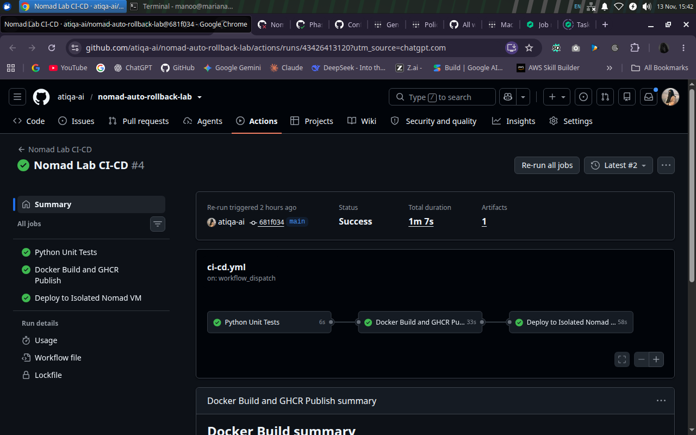
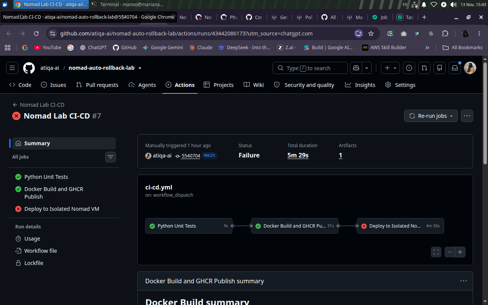
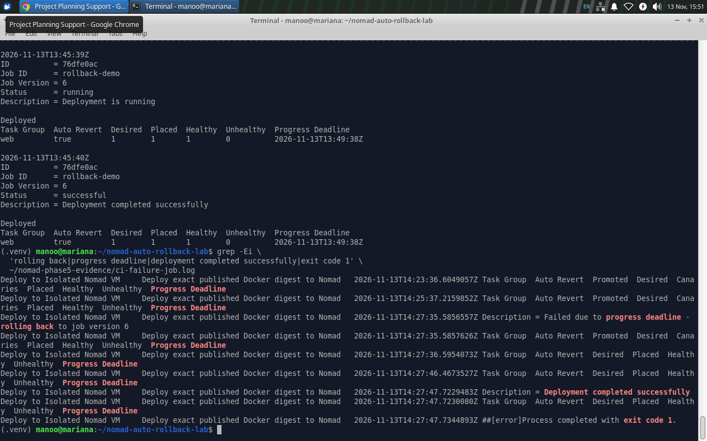

# Phase 5 — Controlled Rollback Test and Results Report

**Date:** 13 November 2026  
**Environment:** Ubuntu VM `mariana`; Nomad `rollback-demo` in `dc1`  
**Test type:** Non-production, intentional failure injection and recovery  
**Overall result:** All planned Phase 5 release/recovery exercises verified; timing results must be interpreted by their start/end definitions.

## 1. Test purpose

Demonstrate that an unhealthy candidate is **not promoted**, that automatic and manual recovery can restore a stable service, and that GitHub Actions does **not** misreport the failed candidate as a successful release merely because recovery succeeded.

## 2. Pre-test state

Prior to tests, a healthy commit-derived v1 job and successful Phase 4 CI deployment had been recorded. The test progressed to stable demonstration version `v2`, and automatic GitHub CD was switched off for manual Nomad exercises. Evidence was saved under `~/nomad-phase5-evidence` in the VM.

## 3. Healthy v2 canary — PASS

| Field | Observed result |
| --- | --- |
| Job | `rollback-demo` |
| Candidate | `APP_VERSION=v2`, `HEALTH_MODE=healthy` |
| Image digest | `sha256:91da3b79ae46fe7b3773b82be788119dc36c39f92b9300e7add5cdb8717066ec` |
| Deployment ID | `5f0c7bd0` |
| Nomad version | `2` |
| Start/completion | 13:00:30 → 13:00:43 UTC |
| Promotion | `true` |
| Healthy / Unhealthy | `1 / 0` |
| HTTP check | `/version` `v2`; `/health` `healthy` |
| Verdict | PASS |

## 4. Automatic rollback after unhealthy v3 — PASS

An unhealthy candidate was validated and planned; the scheduler allocated a canary. `HEALTH_MODE=unhealthy` caused the service check to reject it. The candidate did not reach healthy status and was not promoted.

| Event | Recorded outcome |
| --- | --- |
| Candidate | `APP_VERSION=v3`; Nomad version 3 |
| Deployment | `752b186e` |
| Started | 13:31:16 UTC |
| Unhealthy observation | 13:33:16 UTC, `healthy=0`, `unhealthy=1` |
| Failed | 13:35:16 UTC, progress deadline |
| Nomad message | “rolling back to job version 2” |
| Recovery deployment | `36110492`, recovery job version 4 |
| Recovery success | 13:35:28 UTC, `healthy=1` |
| Command result | `exit code 1` — expected for failed candidate |
| Whole command duration | `252 seconds` |
| Final endpoint | `version=v2, health=healthy` |

**Interpretation:** About 12 seconds from failure/rollback message to successful recovery event. The preceding ~4-minute unhealthy-canary interval is intentional and part of failure detection. The 252-second command duration is not an application outage measurement.

## 5. Manual revert after deliberately disabling auto-revert — PASS

Only a temporary test copy (`~/nomad-phase5-evidence/manual-test.nomad.hcl`) changed `auto_revert=true` to `false`; the original source job file was preserved. This avoided automatically reverting the deliberately failed manual experiment before an operator could issue a command.

| Event | Recorded outcome |
| --- | --- |
| Candidate | `v3-manual`, Nomad version 5 |
| Failure deployment | `4b1f2d2d` |
| Failure timestamp | 13:45:08 UTC, progress deadline |
| Target historical stable version | Job version 4 (healthy v2 configuration) |
| Recovery command | `nomad job revert rollback-demo 4` |
| Manual recovery deployment | `76dfe0ac` |
| New stable job version | `6` |
| Recovery completion | 13:45:40 UTC |
| Command exit status | `0` |
| Recorded manual-revert command time | `12 seconds` |
| Post-check | `version=v2, health=healthy` |

**Interpretation:** The manual command duration begins *after* failure recognition; it must not be compared as an equivalent end-to-end interval to the automatic test's 252 seconds.

## 6. CI-driven unhealthy canary and failure propagation — PASS

**GitHub Actions run:** `43442086173`  
**Main commit:** `55407040f51bbcce07a157f5004cb8f1c26363f3`  
**Published SHA256:** `0c4c1f3120846efb11aec72fef4a48575074b9b2c09b4353c5979f3e291073d2`

| Stage / event | Recorded result |
| --- | --- |
| Python unit tests | Successful in `9s` |
| Docker Build + GHCR Publish | Successful in `31s` |
| Tailscale runner join / SSH | Successful |
| Deployment health mode | `unhealthy` |
| Candidate Nomad job version | `7` — later marked unstable |
| Candidate failure | 14:27:35 UTC, progress deadline |
| Scheduler action | Auto-revert to stable version 6 |
| Recovery success | 14:27:47 UTC, recovery job version 8 |
| GitHub deploy job | Failed (`exit code 1`), as required |
| Overall Actions run | Failure, as required for rejected candidate |

The CI runner **did not** report successful deployment after rollback. Logs explicitly tie the failure to the Nomad progress deadline—not to GHCR publishing, Tailscale login, or SSH transport.

## 7. Final system verification — PASS

The latest supplied terminal verification returned:

```text
ID rollback-demo
Status running
Latest deployment f2b389f5: successful
Task group web: desired 1, placed 1, healthy 1, unhealthy 0
Nomad job version 8: Stable true
PASS: ... version=v2, health=healthy
```

`LAB_CD_ENABLED=false` was explicitly reconfirmed after the CI failure test. The VM-local evidence directory listed 14 saved files at the end of testing.

## 8. Time measurements and interpretation

| Metric | Value | Exact boundary |
| --- | --- | --- |
| Standalone v3 total | 252 seconds | Shell start before `nomad job run` → process return after recovery |
| v3 automatic recovery | ~12 seconds | Failed deployment event 13:35:16 → successful recovery 13:35:28 |
| Manual revert execution | 12 seconds | Start of `nomad job revert` → command return |
| CI automatic recovery | ~12 seconds | CI failure/rollback 14:27:35 → recovery success 14:27:47 |

No real-time user traffic monitor was continuously sampled. Therefore **MTTR, downtime, uptime percentage, loss of requests and near-zero-downtime claims cannot be confirmed from these records**.

## 9. Evidence locations and screenshot notes

Historic VM files: `v3-failure.log`, `manual-failure.log`, `manual-revert.log`, `ci-failure-job.log`, `ci-final-health.txt`, `ci-rollback-history.txt`, `ci-final-result.txt`. The report ZIP includes **screenshots**, not these full VM logs, because the logs remained on the user's VM. The [evidence index](EVIDENCE_INDEX.md) specifies which captures prove which statements and which checks must be repeated for a current state.


*Figure 1 — Full healthy pipeline: tests, publication and deployment all succeeded.*


*Figure 2 — Intended CI result: tests and publication pass, unhealthy deployment fails.*


*Figure 3 — Health deadline failure, rollback initiation, successful recovery and nonzero CI exit.*

## 10. Closure decision

**Phase 5 is complete** for the lab's specified scenarios: healthy canary, failed canary, automatic reversion, manual reversion, measured recovery events and CI failure propagation. Performance characterization, outage/SLO measurement, security hardening and fresh-VM one-command bootstrapping are separately tracked as limitations and future work, not as failed results of these deliberately scoped experiments.
