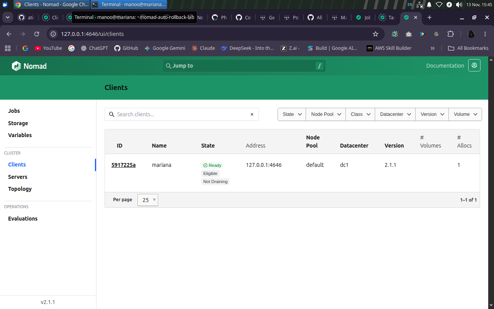
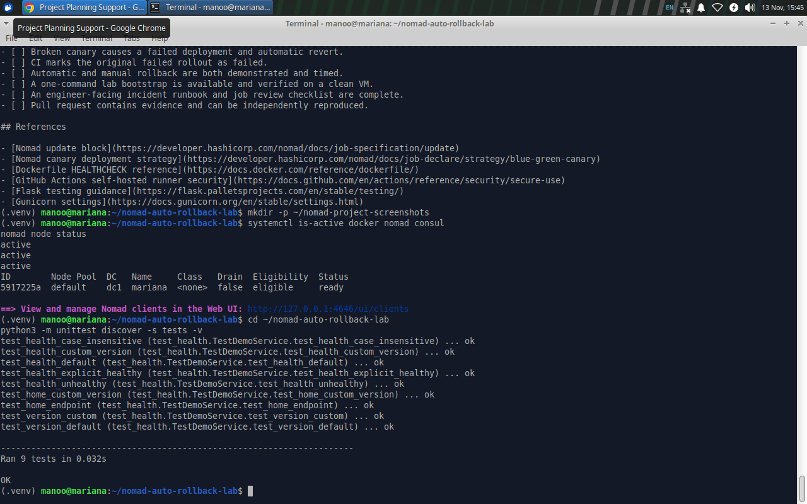
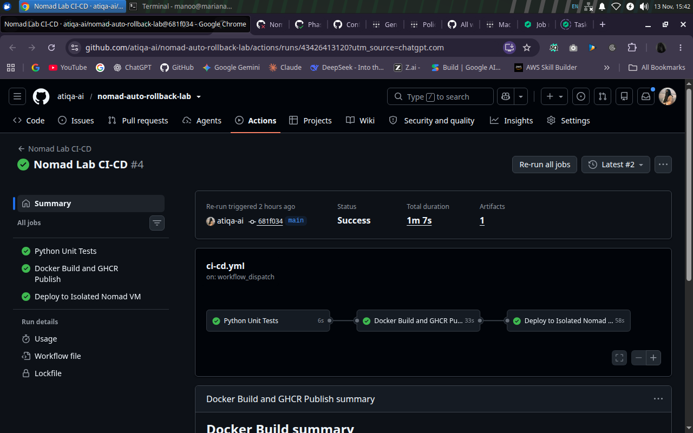
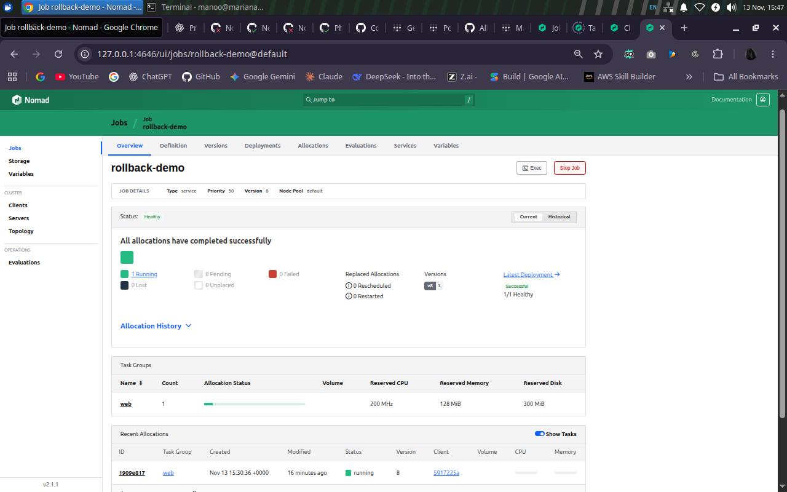
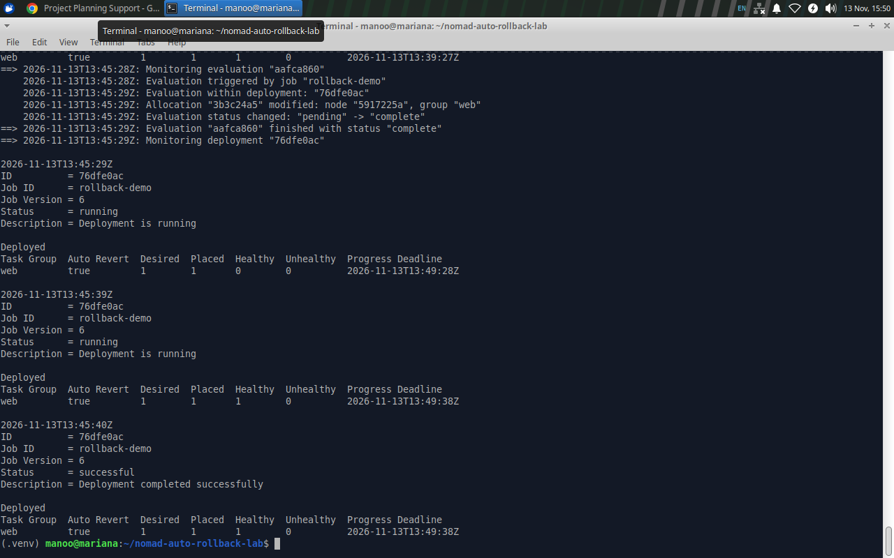
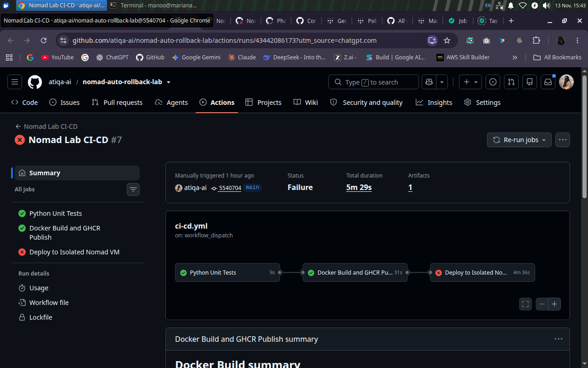
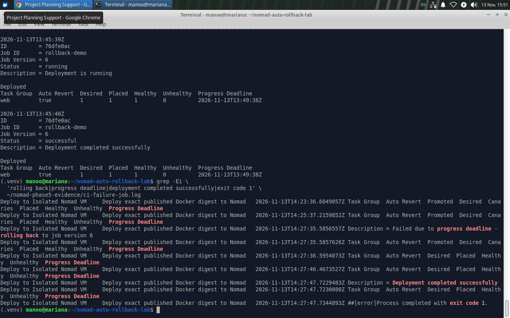
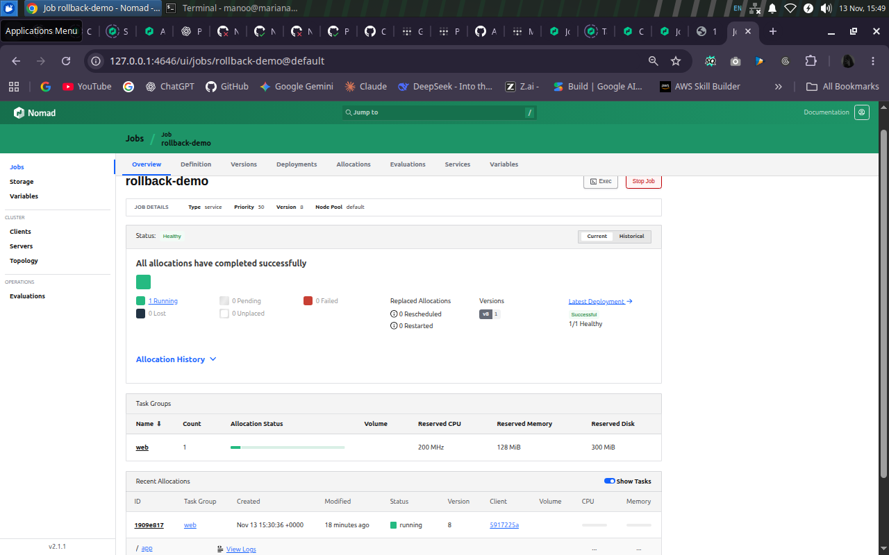

# Final Technical Project Report
## Nomad Automatic Rollback Lab

**Report date:** 13 November 2026  
**Project category:** DevOps / CI-CD / controlled infrastructure lab  
**Execution scope:** Isolated Ubuntu virtual machine `mariana`  
**Status:** Engineering phases 1–5 completed and evidenced; documentation package prepared for Phase 6 handover  
**Change control:** GitHub repository `atiqa-ai/nomad-auto-rollback-lab`, reviewed pull requests and an opt-in deployment switch

## 1. Executive summary

The Nomad Automatic Rollback Lab demonstrates a safe, observable software release process for a small containerized web application. GitHub Actions tests the code, builds an immutable Docker artifact, and—when explicitly enabled—deploys it to HashiCorp Nomad in an isolated Ubuntu VM. Nomad uses canary updates and Consul HTTP health checks to decide whether a candidate is healthy enough to promote. Deliberately unhealthy candidates are rejected; configured auto-reversion restores the previously stable job configuration. Crucially, the initiating GitHub Actions run still fails, rather than hiding the unsuccessful release behind the successful recovery.

The delivered demonstration includes a Flask application with configurable version and health behavior, nine automated unit tests, GHCR image publishing, protected VM connectivity through Tailscale and SSH, Nomad deployments, controlled failure injection, manual rollback, and recorded evidence. The most recent supplied verification shows stable job version **8**, a healthy `v2` response, and automatic deployments disabled following the test.

## 2. Problem and motivation

A successful image build does not guarantee a safe release. A new application container may start yet return a failed readiness/health response. Without deployment health gates, an operator may promote a broken candidate or leave a failed rollout unresolved. Likewise, a pipeline may incorrectly appear green if it treats a successful rollback as success for the original release. This project isolates those failure modes in a reproducible learning environment and makes the release outcome visible in both the scheduler and CI/CD system.

## 3. Objectives and acceptance boundaries

1. Build and test a minimal version-aware HTTP application.
2. Produce and publish commit-identifiable Docker artifacts, deploying by immutable image digest.
3. Integrate a protected GitHub Actions runner-to-VM deployment path.
4. Deliver changes through Nomad canary updates controlled by Consul HTTP health checks.
5. Automatically recover from a deliberately unhealthy release while retaining failed-release visibility.
6. Demonstrate manual recovery with recorded timing and evidence.
7. Provide operational, security, testing and handover documentation for a personal lab.

**Not part of the verified implementation:** production multi-node high availability; zero-downtime measurement; service-level objective/SLA validation; production security hardening; a confirmed one-command fresh-VM bootstrap. These are deliberately reported as gaps, not accomplishments.

## 4. Implemented solution

### 4.1 Application and container

A Python Flask application exposes `GET /`, `GET /health` and `GET /version`. `APP_VERSION` controls the displayed version; `HEALTH_MODE=healthy` returns a passing health state and `HEALTH_MODE=unhealthy` creates an intentional HTTP 503 failure. It is a controlled exercise: an unhealthy response is not assumed to represent an unanticipated defect in unrelated application code. Gunicorn serves port 8080 from a non-root image configuration. The historical record documents a Gunicorn control-socket issue and a later `--no-control-socket` correction; a separate clean-container regression log for that correction is not included in the supplied evidence.

### 4.2 CI/CD and artifact identity

GitHub Actions runs Python unit tests on proposed changes. On `main` runs, it builds and publishes a Docker image to GHCR under a commit-specific SHA tag and supplies its immutable SHA256 digest to deployment. Deployment is controlled by `LAB_CD_ENABLED`; it is not run by default when the switch is `false`. The deployment workflow uses a tagged temporary Tailscale connection and pinned SSH host key to reach `mariana`. The VM-side deployment script validates its input SHA and digest, confirms the commit is on `main`, performs Nomad validation and planning, uses `-check-index` to limit concurrent update races, and monitors the job outcome. The Phase 5 opt-in `failure_test` workflow input selects `HEALTH_MODE=unhealthy` only for intentional testing.

### 4.3 Nomad, Consul and release control

The `rollback-demo` Nomad job uses one `web` task allocation, host networking to the container's port 8080, a Consul-registered HTTP health check on `/health`, and these tested update-policy values:

| Setting | Value | Role |
| --- | --- | --- |
| `count` | `1` | One desired stable service instance |
| `canary` | `1` | Start one candidate allocation before promotion |
| `max_parallel` | `1` | Bound parallel service-group updates |
| `auto_promote` | `true` | Promote the candidate after health requirements pass |
| `auto_revert` | `true` | Restore last stable job after failed deployment |
| `health_check` | `checks` | Use service checks for health evaluation |
| `min_healthy_time` | `10s` | Require a minimum passing period |
| `healthy_deadline` | `2m` | Bound time to achieve healthy state |
| `progress_deadline` | `4m` | Fail a rollout that stops progressing |
| Consul check | HTTP `/health`, every `5s`, timeout `2s` | Evaluates actual app health |

The system is a single-VM personal lab, not a distributed control plane. The recorded final state was one running and one healthy allocation.

## 5. Architecture and release sequence

```text
Reviewed source / workflow_dispatch
              |
              v
       GitHub Actions
     [Python unit tests]
              |
              v
    Docker build + GHCR
       immutable digest
              |
   LAB_CD_ENABLED == true?
              |
              v
    Tailscale temporary runner
       SSH pinned host key
              |
              v
       Ubuntu VM mariana
     Nomad service job web
              |
        Canary allocation
              |
       Consul HTTP /health
       /                 \
  healthy                  unhealthy
     |                         |
 auto-promote            deadline failure
     |                         |
 stable new job          auto-revert to last stable
                               |
                        CI deployment stays failed
```

The actual `nomad job run` output and CI logs demonstrate both branches; see the detailed [rollback tests](PHASE5_ROLLBACK_TEST_REPORT.md).

## 6. Implementation methodology

The engineering work was performed in six planned phases. **Phases 1–5** were completed and demonstrated; **Phase 6** is documentation, reproducibility review and handover.

| Phase | Implemented activity | Evidence basis |
| --- | --- | --- |
| 1 — Preparation | Isolated VM, Git, Docker/Nomad/Consul environment checks | Active daemons and ready Nomad client |
| 2 — Application | Flask service, unit tests, Docker healthy/unhealthy behavior | Nine passing tests; earlier container response evidence |
| 3 — Orchestration | Nomad service job, Consul health and baseline v1 deployment | Running job and stable history |
| 4 — CI/CD | GitHub Actions tests, GHCR digest, Tailscale/SSH VM deployment | Green run `43426413120` |
| 5 — Recovery | Healthy v2, automatic and manual rollback, CI failure propagation | Nomad job/deployment logs, failed run `43442086173` |
| 6 — Handover | Report, runbook, audit, evidence index and safety checklist | Documentation ZIP; clean-VM reproduction not yet independently tested |

## 7. Test execution and actual results

### 7.1 Unit and container tests

A terminal screenshot on `mariana` records **9 tests run, 9 successful**, using `python3 -m unittest discover -s tests -v`. Earlier Docker exercise outputs reported HTTP 200 for a healthy instance and HTTP 503 for an intentionally unhealthy instance. These results validate the controlled health mode; they are not performance/load testing.

### 7.2 Healthy canary deployment

On **13 November 2026 at 13:00:30 UTC**, a healthy candidate with `APP_VERSION=v2` was submitted using an immutable GHCR image digest. Deployment `5f0c7bd0` (Nomad job version **2**) completed successfully at 13:00:43 UTC: **promoted=true**, **healthy=1**, **unhealthy=0**. Independent endpoint responses were `{"version":"v2"}` and `{"status":"healthy","version":"v2"}`.

### 7.3 Automated recovery exercise

A deliberately broken v3 canary (Nomad version **3**, deployment `752b186e`) started at 13:31:16 UTC. It did not become healthy, was not promoted, and failed at 13:35:16 UTC due to the progress deadline. Nomad logged that it was **rolling back to job version 2**. Recovery deployment `36110492` produced job version **4** and succeeded at 13:35:28 UTC. The full `nomad job run` command exited `1`, correctly signaling failed release, and its measured wall time was **252 seconds**. Post-recovery responses showed healthy v2.

### 7.4 Manual revert exercise

With `auto_revert=false` in a temporary **test copy** of the HCL, candidate `v3-manual` became failed job version **5**, deployment `4b1f2d2d`, at 13:45:08 UTC. The operator then invoked `nomad job revert rollback-demo 4`. Recovery deployment `76dfe0ac` (job version **6**) succeeded at 13:45:40 UTC, with exit code `0` and a measured **12-second revert command duration**. The application again returned healthy v2.

### 7.5 End-to-end CI failure propagation

On GitHub Actions run **43442086173**, the Python test job passed in **9 seconds** and GHCR build/publish passed in **31 seconds**. The workflow supplied `HEALTH_MODE=unhealthy`, published immutable digest `sha256:0c4c1f3120846efb11aec72fef4a48575074b9b2c09b4353c5979f3e291073d2`, and attempted deployment of main commit `55407040f51bbcce07a157f5004cb8f1c26363f3`. The candidate failed its Nomad progress deadline at **14:27:35 UTC** and Nomad logged automatic rollback to stable job version **6**. Recovery was reported successful at **14:27:47 UTC**. The GitHub deployment job and overall run remained failed (`exit code 1`). Later verification showed version **8** stable and healthy v2.

### 7.6 Consolidated result matrix

| Requirement | Evidence and observed outcome | Verdict |
| --- | --- | --- |
| Nine unit tests | `Ran 9 tests` / `OK` on `mariana` | Pass |
| Full healthy CI/CD release | Three green jobs in run `43426413120` | Pass |
| GHCR immutable digest deployment | Commit-matched SHA digest supplied to Nomad | Pass |
| Healthy canary auto-promotion | Version 2, `promoted=true`, `healthy=1` | Pass |
| Unhealthy canary rejection | Version 3 failed progress deadline | Pass |
| Automatic revert | Failed v3 restored stable v2 configuration | Pass |
| Manual revert | Revert to version 4, exit 0, recovery success | Pass |
| CI failure propagation | Deliberate workflow run failed after successful recovery | Pass |
| Final health | `version=v2, health=healthy`, stable job version 8 | Pass |
| Clean VM one-command bootstrap | No independent fresh-VM run recorded | **Not verified** |
| Zero-downtime SLO | No continuous external availability measurements | **Not measured** |

## 8. Recovery metrics: interpretation and limits

| Exercise | Recorded interval | Interpretation |
| --- | --- | --- |
| Standalone unhealthy v3 test | `252s` | Whole failed rollout command through recovery, including detection deadlines |
| Automatic recovery segment | `~12s` | From 13:35:16 failure log to 13:35:28 successful recovery |
| Manual revert command | `12s` | From operator execution to successful return, **after** the failure was recognized |
| CI-triggered recovery segment | `~12s` | From 14:27:35 failure/rollback log to 14:27:47 successful recovery |

These figures have different start events and **must not be treated as like-for-like recovery-time benchmarks**. No independent continuous traffic probe, outage measurement, throughput test, or SLA claim was produced.

## 9. Security and governance controls

The demonstrated lab uses separate GitHub environment secrets for Tailscale OAuth and SSH identity, repository variables for target VM and a guarded deployment switch, a GHCR digest rather than a mutable `latest` tag, and a pinned SSH host key. The Nomad and Consul management APIs were kept on VM loopback; Tailscale tags scoped the runner-to-VM path to TCP 22. Source updates were reviewed via pull requests; the intentionally unhealthy `workflow_dispatch` input was limited to a controlled demonstration.

Remaining production gaps include Nomad ACL/mTLS, Consul ACLs, secret rotation records, a hardened low-privilege deployment identity, multi-node fault tolerance, guaranteed artifact provenance verification beyond the recorded digest, and a security review of workflow permissions. Do **not** describe this project as production-secure.

## 10. Limitations and operational concerns

- Single Nomad node and single desired service allocation; no high-availability claim.
- Health-check-based failure detection, not complete application correctness or user-experience assurance.
- No verified one-command bootstrap or measured full clean-room replay.
- CI-induced failure injection intentionally exercises a bad configuration and must remain restricted to authorized testing.
- Recovery may preserve user-visible service, but **zero downtime was not measured**.
- Historic demo version `v2` is not necessarily the same as a source commit or Docker digest; version labels and image identity must be distinguished.
- Phase 2 historic Gunicorn correction has no separately supplied post-fix container-log proof, despite later successful Nomad/GHCR execution.
- The supplied evidence images include two similar Nomad overview captures and a manual-revert screen without the original `revert` invocation in view; corresponding terminal logs provide the command-level evidence.

## 11. Outcome and conclusion

The project demonstrated the principal engineering objective: safe canary rollout decisions based on live service checks and controlled recovery from a broken release, with failure propagated back to GitHub Actions. Healthy v2 was promoted, intentionally unhealthy versions were rejected, automatic and manual recovery were each exercised, and final verification showed a healthy service. The key result is correct **release-state accounting**: restoring an older stable application does not retroactively make the broken candidate successful.

This is a completed **lab demonstration** with a handover documentation set. Future engineering priorities are a clean-VM end-to-end bootstrap test, continuous availability instrumentation, strengthened deployment credentials/ACLs, deeper resilience testing, and retention of evidence as a versioned release artifact.

## 12. Document map and submitted evidence

- Full design: [architecture](architecture.md)
- Prerequisites and reproduction: [installation guide](INSTALLATION_AND_REPRODUCIBILITY.md)
- Operational steps: [runbook](OPERATIONAL_RUNBOOK.md)
- Tested outcomes: [Phase 5 report](PHASE5_ROLLBACK_TEST_REPORT.md) and [validation matrix](VALIDATION.md)
- Safety and residual risks: [security assessment](SECURITY_AND_RISKS.md)
- Screenshot-by-screenshot register: [evidence index](EVIDENCE_INDEX.md)
- Transfer and acceptance: [handover checklist](FINAL_HANDOVER_CHECKLIST.md)

## Appendix A — Additional screenshot evidence

The following eight visual records supplement the test-result tables and log summary. Images are historical captures provided on 13 November 2026. They should not be interpreted as live monitoring output.

{width=6.15in}

*Figure 01 — Docker, Nomad and Consul service readiness, plus Nomad client state.*

{width=6.15in}

*Figure 02 — Nine passing Python application unit tests in the Ubuntu VM.*

{width=6.15in}

*Figure 03 — Verified healthy release with passing tests, image publish and VM deployment.*

{width=6.15in}

*Figure 04 — Post-recovery Nomad job overview: stable version 8 and healthy allocation.*

{width=6.15in}

*Figure 05 — Manual recovery event reaches a successful job version; original command in the saved log.*

{width=6.15in}

*Figure 06 — Controlled unhealthy candidate: test/build jobs passed and deployment failed.*

{width=6.15in}

*Figure 07 — Deadline failure, revert to stable configuration and CI exit code 1.*

{width=6.15in}

*Figure 08 — Final successful Nomad deployment dashboard; independent HTTP v2 health is recorded separately.*
