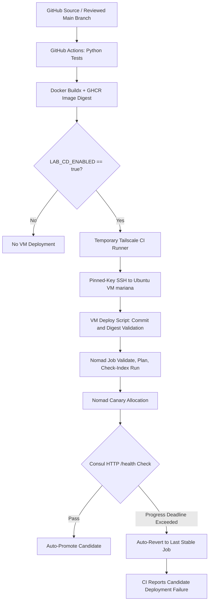

# Architecture and Technical Design

**Status:** Implemented and exercised in an isolated single-VM lab, 13 November 2026. This document describes the **verified design** rather than an unbuilt target architecture.

## 1. Deployment Topology



The Mermaid diagram represents the verified deployment workflow. Operational behavior is supported by Nomad deployment history and GitHub Actions execution logs.

## 2. Components and Responsibilities

| Component | Responsibility | Boundary |
|---|---|---|
| Flask Application | Provides `/`, `/health`, and `/version` endpoints with configurable health and version | Demonstration application only |
| Gunicorn / Docker | Serves the isolated application on port 8080 | Non-root container configuration |
| Python unittest | Verifies nine application HTTP behaviors | Unit tests do not independently prove deployment correctness |
| GitHub Actions | Executes tests, builds images, publishes artifacts, and optionally deploys | Controlled by main-branch and deployment-variable gates |
| GHCR | Stores container images published by CI with immutable digests | Artifact storage, not a live health checker |
| Tailscale | Provides private connectivity between GitHub runner and Ubuntu VM | Tagged `tag:ci` to `tag:nomad-lab`, TCP 22 |
| SSH | Securely invokes the VM deployment command | Pinned host key and dedicated lab identity |
| VM Deployment Script | Validates commit SHA and digest, tracks `main`, plans, and monitors deployments | Operates only within the isolated lab |
| Nomad | Schedules stable and canary allocations, manages promotion and automatic revert | Single-node lab, `dc1`, job `rollback-demo` |
| Consul | Provides service discovery and HTTP `/health` checks | Local API, separate from Docker health checks |
| Evidence Records | Preserve logs, screenshots, deployment outcomes, and recovery timings | Historical evidence, not continuous monitoring |

## 3. Application Interface

| Route | Healthy Scenario | Controlled Failure Scenario |
|---|---|---|
| `GET /` | Returns JSON service information | Returns JSON service information |
| `GET /version` | Returns JSON `{"version":"v2"}` (example) | Version label remains queryable if service is reachable |
| `GET /health` | HTTP 200 with `{"status":"healthy",...}` | HTTP 503 with `{"status":"unhealthy",...}` |

### Application Configuration

The application uses two environment variables:

- **`APP_VERSION`:** Defines the displayed application version.
- **`HEALTH_MODE`:** Controls healthy or intentionally unhealthy application behavior.

`APP_VERSION` is a display label and must not be confused with the published Docker image digest.

The application container exposes port `8080`. Nomad assigns a dynamic host port, and Consul registers the corresponding service endpoint.

## 4. Nomad Release Behavior

### 4.1 Canary Deployment Configuration

The verified Nomad job configuration uses the following update strategy.

| Configuration | Value | Purpose |
|---|---|---|
| `count` | `1` | Maintains one desired application allocation |
| `canary` | `1` | Starts one candidate allocation |
| `auto_promote` | `true` | Automatically promotes a healthy candidate |
| `auto_revert` | `true` | Reverts to the last stable job version after deployment failure |
| `health_check` | `"checks"` | Evaluates registered service health checks |
| `min_healthy_time` | `"10s"` | Requires a minimum healthy period |
| `healthy_deadline` | `"2m"` | Sets the allocation health deadline |
| `progress_deadline` | `"4m"` | Sets the deployment progress deadline |
| `max_parallel` | `1` | Limits parallel allocation updates |
| `shutdown_delay` | `"5s"` | Provides a shutdown delay during replacement |

### 4.2 Consul Health Check

The service health check uses:

| Parameter | Value |
|---|---|
| Check Type | HTTP |
| Endpoint | `/health` |
| Interval | `5s` |
| Timeout | `2s` |
| Health Provider | Consul |

Nomad evaluates registered health checks before determining whether a candidate is eligible for promotion.

### 4.3 Healthy Deployment Behavior

The healthy v2 candidate successfully passed the configured health checks and was automatically promoted.

Verified results:

- Nomad job version `2` became stable.
- Deployment `5f0c7bd0` completed successfully.
- Canary promotion was successful.
- One allocation was healthy.
- No unhealthy allocations remained.
- The application returned version `v2` and status `healthy`.

### 4.4 Automatic Rollback Behavior

The intentionally unhealthy v3 candidate failed the Consul health check and was not promoted.

The deployment exceeded its configured progress deadline. Nomad marked the deployment as failed and initiated an automatic revert to the previously stable job configuration.

Verified results:

- Unhealthy candidate job version: `3`
- Failed deployment ID: `752b186e`
- Rollback target: stable job version `2`
- Recovery job version: `4`
- Successful recovery deployment: `36110492`
- Restored application version: `v2`
- Final application health: `healthy`

### 4.5 Manual Rollback Behavior

A separate controlled test was performed to verify operator-initiated recovery.

A temporary copy of the Nomad job specification changed `auto_revert` to `false`, allowing the unhealthy deployment to fail without automatically reverting the job configuration.

The original repository configuration remained unchanged.

Verified results:

- Failed test job version: `5`
- Failed deployment ID: `4b1f2d2d`
- Manual rollback command: `nomad job revert rollback-demo 4`
- New recovery job version: `6`
- Successful recovery deployment: `76dfe0ac`
- Manual revert command exit code: `0`
- Recorded manual revert execution: `12 seconds`

Following manual recovery, normal automatic revert configuration was restored.

## 5. CI/CD Job Boundaries

### 5.1 Pull Request Validation

Pull request workflows execute application unit tests.

The following behavior was verified:

- Python unit tests execute.
- Image publishing is skipped.
- VM deployment is skipped.
- Pull request checks report the test result.

### 5.2 Main Branch and Manual Workflow Execution

The GitHub Actions pipeline performs these operations:

1. Checks out the application source.
2. Runs Python unit tests.
3. Configures Docker Buildx.
4. Builds the application container image.
5. Publishes the image to GitHub Container Registry.
6. Produces an immutable SHA256 image digest.
7. Checks the deployment safety gate.
8. Connects to the private VM when deployment is enabled.
9. Invokes the VM deployment script.
10. Reports the resulting deployment status.

### 5.3 Deployment Requirements

A deployment requires:

- `LAB_CD_ENABLED=true`
- Execution from the reviewed `main` branch
- Access to the `nomad-lab` GitHub environment
- Valid Tailscale OAuth credentials
- Valid SSH authentication and pinned host-key verification
- A reachable isolated Ubuntu VM
- A validated Nomad job specification

When `LAB_CD_ENABLED=false`, the deployment job is skipped.

### 5.4 Controlled Failure Testing

The GitHub Actions workflow supports an optional manual input:

`failure_test=true`

When this input is selected, the workflow submits an intentionally unhealthy candidate.

Normal deployment behavior defaults to `healthy`.

The controlled test verified that:

- Python unit tests passed.
- Docker image build and GHCR publishing succeeded.
- Tailscale connectivity succeeded.
- SSH-based deployment execution started.
- Nomad submitted the unhealthy candidate.
- The candidate failed its progress deadline.
- Nomad automatically reverted to the stable configuration.
- The recovery deployment completed successfully.
- GitHub Actions reported deployment failure with exit code `1`.

A successful rollback does not change the original candidate deployment from failed to successful.

### 5.5 Verified GitHub Actions Runs

| Workflow | Run ID | Result |
|---|---|---|
| Successful CI/CD Deployment | `43426413120` | Successful |
| Controlled Failure and Automatic Rollback | `43442086173` | Expected failure reported |

The controlled failure workflow demonstrated failure propagation from Nomad to GitHub Actions while allowing automatic application recovery.

## 6. Network and Trust Boundary

### 6.1 Network Architecture

```text
GitHub-Hosted Runner (Ephemeral)
              |
              v
       Tailscale tag:ci
              |
        Allowed TCP 22
              |
              v
     Tailscale tag:nomad-lab
              |
              v
     SSH to Ubuntu VM mariana
          User: manoo
              |
              v
        VM Deployment Script
              |
              v
         Local Nomad CLI
         127.0.0.1:4646
              |
              v
       Nomad Job and Allocations
              |
              v
         Consul Service Check
         127.0.0.1:8500
              |
              v
         Dynamic Host Port
              |
              v
       Docker Container: 8080
              |
              v
       Flask Application /health
```

The diagram illustrates the deployment control path and service-health relationship. Nomad and Consul interact locally during scheduling and health evaluation.

### 6.2 Security Boundaries

The implementation follows these lab-level security controls:

- Nomad and Consul management APIs are bound to local interfaces.
- The VM is accessed through a private Tailscale network.
- Tagged Tailscale identities restrict the intended CI-to-VM connection.
- SSH uses a dedicated authentication identity.
- SSH host-key verification is pinned.
- GitHub environment secrets store sensitive deployment credentials.
- Deployment images are identified using immutable SHA256 digests.
- Repository source files do not need to contain deployment credentials.
- Deployment activity is restricted to the isolated lab.

### 6.3 Infrastructure Limitations

The environment operates on one Ubuntu virtual machine.

It does not provide:

- Multi-node Nomad availability.
- Redundant Consul servers.
- Automatic VM replacement.
- Recovery from physical host failure.
- Production-grade disaster recovery.

A VM or host failure may interrupt the application because redundant infrastructure is outside the verified project scope.

## 7. Failure-State Transitions

| State | Trigger | Scheduler Behavior | Verified Example |
|---|---|---|---|
| Stable | Current instance passes health checks | Maintains the healthy service | Healthy v2 |
| Canary Pending | New job version is submitted | Starts candidate and evaluates checks | v3 candidate, version 3 |
| Candidate Unhealthy | `/health` check fails | Does not promote candidate | `healthy=0`, `unhealthy=1` |
| Failed Deployment | Progress deadline expires | Marks deployment failed | `752b186e`, `4b1f2d2d` |
| Auto-Reverting | Automatic revert is enabled | Restores last stable configuration | Recovery versions 4 and 8 |
| Manual Revert | Operator invokes `nomad job revert` | Restores selected historical job | Recovery version 6 |
| Recovered | Stable service checks pass | Reports successful recovery deployment | Healthy v2 restored |

### 7.1 Verified Recovery Results

| Test | Actual Result |
|---|---|
| Healthy v2 Canary | Successfully promoted |
| Unhealthy v3 Canary | Failed as expected |
| Automatic Rollback | Stable v2 configuration restored |
| Manual Rollback | Successfully executed |
| Manual Revert Duration | 12 seconds |
| CI-Triggered Automatic Recovery Stage | Approximately 12 seconds |
| GitHub Actions Failure Reporting | Exit code `1` |
| Final Nomad Job Version | `8`, stable |
| Final Deployment ID | `f2b389f5` |
| Final Application Version | `v2` |
| Final Application Health | `healthy` |

### 7.2 Recovery Timing Interpretation

The first automatic rollback test recorded a total duration of **252 seconds** from deployment command execution through completed recovery.

The recovery stage itself took approximately **12 seconds**, based on the recorded failure and successful recovery timestamps.

The manual revert command also completed in **12 seconds**.

These measurements represent different execution intervals:

- The 252-second result includes failure detection and recovery.
- The automatic recovery-stage result measures the rollback completion interval.
- The manual result measures execution of the revert command after the failed deployment.

They must not be presented as directly comparable total recovery times or as independently measured application downtime.

## 8. Observability and Evidence Limitations

### 8.1 Verified Observability

The project successfully verified:

- Consul-passing application health checks.
- Nomad job and allocation status.
- Successful and failed deployments.
- Canary promotion behavior.
- Application `/health` and `/version` responses.
- Automatic rollback execution.
- Manual rollback execution.
- GitHub Actions workflow status.
- Deployment and recovery timestamps.
- Final stable application health.

### 8.2 Evidence Sources

The lab evidence includes:

- Python unit test results.
- Docker container validation.
- Nomad job history.
- Nomad deployment history.
- Consul service health.
- GitHub Actions successful workflow.
- GitHub Actions expected-failure workflow.
- Automatic rollback logs.
- Manual rollback logs.
- Final health verification.
- Dated screenshots.

These records support the reported test outcomes.

### 8.3 Observability Limitations

The project does not include independently verified:

- Long-duration external traffic monitoring.
- Continuous synthetic availability checks.
- Application latency Service Level Objectives (SLOs).
- Application-level error-rate dashboards.
- Multi-node failover.
- Production-level availability guarantees.
- Independently measured zero-downtime operation.

Recorded timestamps demonstrate deployment and recovery behavior but are not equivalent to measured end-user downtime.

## 9. Configuration and Maintainability

### 9.1 Canonical Implementation Files

| File | Responsibility |
|---|---|
| `.github/workflows/ci-cd.yml` | GitHub Actions CI/CD pipeline |
| `nomad/rollback-demo.nomad.hcl` | Nomad service and canary configuration |
| `scripts/nomad-lab-deploy.sh` | Deployment validation and execution |
| `scripts/phase4-preflight.sh` | Environment preflight verification |
| `scripts/phase4-verify.sh` | Final deployment and health verification |
| `app/app.py` | Flask application |
| `app/requirements.txt` | Application dependencies |
| `tests/test_health.py` | Application unit tests |
| `Dockerfile` | Application container definition |

### 9.2 Change Management Guidelines

For future application or infrastructure changes:

1. Review source changes before merging into `main`.
2. Execute application unit tests.
3. Build and publish a versioned container image.
4. Use the immutable image digest for deployment.
5. Validate the Nomad job specification.
6. Review the Nomad deployment plan.
7. Preserve the stable allocation during canary evaluation.
8. Verify Consul health checks.
9. Monitor deployment status.
10. Keep automatic rollback enabled during normal operation.
11. Record failures and recovery evidence.
12. Store credentials outside the repository.

### 9.3 Deployment Safety

The deployment workflow must not be enabled unnecessarily.

After controlled testing, the repository deployment variable was set to:

```text
LAB_CD_ENABLED=false
```

This disables automatic deployment execution while preserving the configured CI/CD workflow.

Future deployments should require an intentional decision to enable this gate.

### 9.4 Documentation Maintenance

Documentation should be updated whenever changes affect:

- Application interfaces.
- Docker image configuration.
- GitHub Actions workflow behavior.
- Nomad job specifications.
- Consul health checks.
- Deployment safety controls.
- Rollback behavior.
- Security boundaries.
- Acceptance criteria.

Recorded evidence must remain associated with the corresponding deployment version and execution date.

### 9.5 Implementation Boundary

This documentation package describes the verified implementation and does not modify executable project source files.

Before future deployments, compare the current Git `main` branch with the documented configuration and complete the [Deployment Review Checklist](DEPLOYMENT_REVIEW_CHECKLIST.md).

## 10. Architecture Verification Summary

The isolated Nomad lab successfully demonstrated an end-to-end CI/CD and controlled deployment workflow.

The verified implementation includes:

- Python application testing.
- Docker container build and GHCR publishing.
- Secure private CI-to-VM connectivity.
- Nomad canary deployment.
- Consul health-based promotion.
- Rejection of unhealthy releases.
- Automatic restoration of stable configurations.
- Manual operator-initiated rollback.
- GitHub Actions failure propagation.
- Final healthy application recovery.

The architecture meets the demonstrated lab-level deployment and rollback objectives.

The final verified application state was Nomad job version `8`, with one healthy allocation, no unhealthy allocations, and application version `v2`.

The solution remains a single-VM demonstration environment. Production high availability, external uptime monitoring, and clean-VM one-command bootstrap verification are outside the completed evidence.
