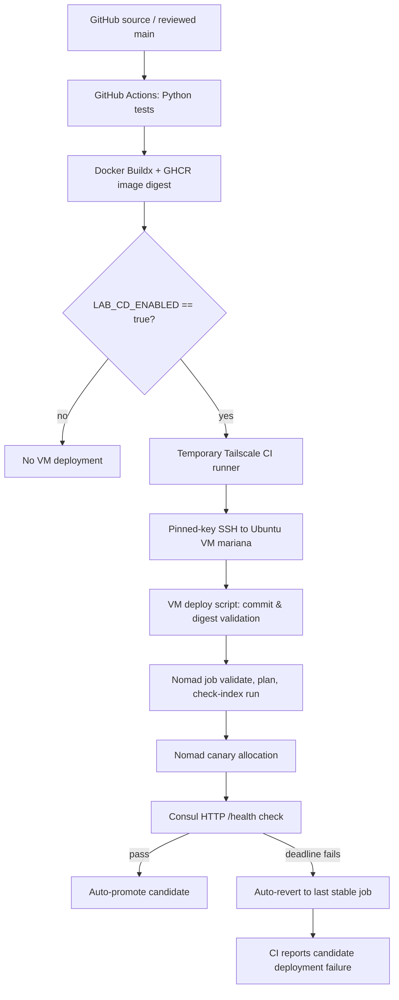

# Architecture and Technical Design

**Status:** Implemented and exercised in an isolated single-VM lab, 13 November 2026. This document describes the **verified design** rather than an unbuilt target architecture.

## 1. Deployment topology



The Markdown diagram is an explanatory representation; operational behavior is supported by Nomad and GitHub execution logs.

## 2. Components and responsibilities

| Component | Responsibility | Boundary |
| --- | --- | --- |
| Flask application | `/`, `/health`, `/version`; configurable test health and version | Demo service only |
| Gunicorn/Docker | Serve isolated application on port 8080 | Non-root container configuration |
| Python unittest | Verify nine HTTP behaviors in source | Passing unit tests do not prove deployment correctness |
| GitHub Actions | Execute tests, publish and optionally deploy | Controlled by main-branch and variable gates |
| GHCR | Store digest-addressed image produced by CI | Artifact storage, not a live health checker |
| Tailscale | Private runner-to-VM connectivity | Tagged `tag:ci` → `tag:nomad-lab`, TCP 22 |
| SSH | Remote invocation of VM deployment command | Pinned host key and dedicated lab identity |
| VM deployment script | Validates SHA/digest, tracks `main`, plans and monitors | Does not change production infrastructure |
| Nomad | Schedules stable and canary allocations; auto-revert | Single-node lab, `dc1`, job `rollback-demo` |
| Consul | Service discovery and HTTP `/health` validation | Local API; distinct from Docker health check |
| Evidence records | Logs, screenshots and historic deployment outcomes | Dated results, not a live monitoring database |

## 3. Application interface

| Route | Healthy scenario | Controlled failure scenario |
| --- | --- | --- |
| `GET /` | JSON service information | JSON service information |
| `GET /version` | JSON `{"version":"v2"}` (example) | Version label still queryable if service reachable |
| `GET /health` | HTTP 200, `{"status":"healthy",...}` | HTTP 503, `{"status":"unhealthy",...}` |

`APP_VERSION` is a **display label**, not an artifact digest. `HEALTH_MODE` controls intentional failure injection. The container exposes port 8080; Nomad assigns a dynamic host port and Consul publishes the service endpoint.

## 4. Nomad release behavior

The recorded job config used one service-group allocation, a `canary=1`, `auto_promote=true`, `auto_revert=true`, `health_check="checks"`, `min_healthy_time="10s"`, `healthy_deadline="2m"`, `progress_deadline="4m"`, `max_parallel=1`, and `shutdown_delay="5s"`. The Consul service check used `/health` with a five-second interval and two-second timeout.

The healthy candidate became stable; the unhealthy v3 candidate never promoted and failed its progress deadline. A temporary test HCL file changed **only** `auto_revert` to `false` to demonstrate manual operator recovery; original repository configuration stayed unchanged. Following manual revert, normal auto-revert behavior was restored.

## 5. CI/CD job boundaries

- **Pull requests:** Run Python tests; publish and deploy jobs skipped.
- **Main updates/manual runs:** Run tests and publish commit-tagged Docker image with immutable digest.
- **Deployment:** Requires `LAB_CD_ENABLED=true`; workflow must run from `main` in trusted environment `nomad-lab`.
- **Controlled failure:** Only manual workflow invocation with `failure_test=true` passes unhealthy mode. Normal mode defaults to healthy.
- **Failure semantics:** An unhealthy deployment makes the deployment job fail even when Nomad completes automatic recovery.

**Historical successful workflow:** `43426413120`. **Historical expected-failure workflow:** `43442086173`.

## 6. Network and trust boundary

```text
GitHub-hosted runner (ephemeral)
       |
    Tailscale tag:ci
       |       allowed TCP 22
    Tailscale tag:nomad-lab
       |
     SSH to mariana (user manoo)
       |
 Local Nomad CLI -> 127.0.0.1:4646
 Local Consul API -> 127.0.0.1:8500
       |
     Nomad Docker task -> dynamic host HTTP port -> app:8080
```

The Nomad and Consul APIs were not advertised for public access. SSH key and Tailscale OAuth details belong in GitHub environment secrets, not source files. The lab depends on a single VM and network path; loss of the VM or its local services is not mitigated by a redundant cluster.

## 7. Failure-state transitions

| State | Trigger | Expected scheduler behavior | Verified example |
| --- | --- | --- | --- |
| Stable | Current instance passes checks | Preserve passing service | Healthy v2 |
| Canary pending | New job version submitted | Start candidate and evaluate checks | v3 candidate, version 3 |
| Candidate unhealthy | `/health` does not pass | Do not promote | `healthy=0`, `unhealthy=1` |
| Failed deployment | Progress deadline reached | Mark version failed; auto-revert if enabled | `752b186e`, `4b1f2d2d` |
| Auto-reverting | Stable configuration selected | New recovery deployment | Version 4, later version 8 |
| Manual revert | Operator invokes `nomad job revert` | Restore selected historical job version | Version 6 after reverting to 4 |

## 8. Observability and evidence limitations

This lab verifies **Consul-passing health, Nomad allocation/deployment status, application response, and GitHub Actions result**. It does not include an independently verified long-duration external traffic probe, latency SLO, or application-level error-rate dashboard for this project. Recovery timestamps come from Nomad and CI logs; they are not a direct downtime metric.

## 9. Configuration and maintainability

Canonical code paths in the existing repository are `.github/workflows/ci-cd.yml`, `nomad/rollback-demo.nomad.hcl`, `scripts/nomad-lab-deploy.sh`, `scripts/phase4-preflight.sh`, and `scripts/phase4-verify.sh`. This documentation package does **not** modify those executable files. Before a future change, compare working Git `main` with the recorded design and use the [deployment review checklist](DEPLOYMENT_REVIEW_CHECKLIST.md).
